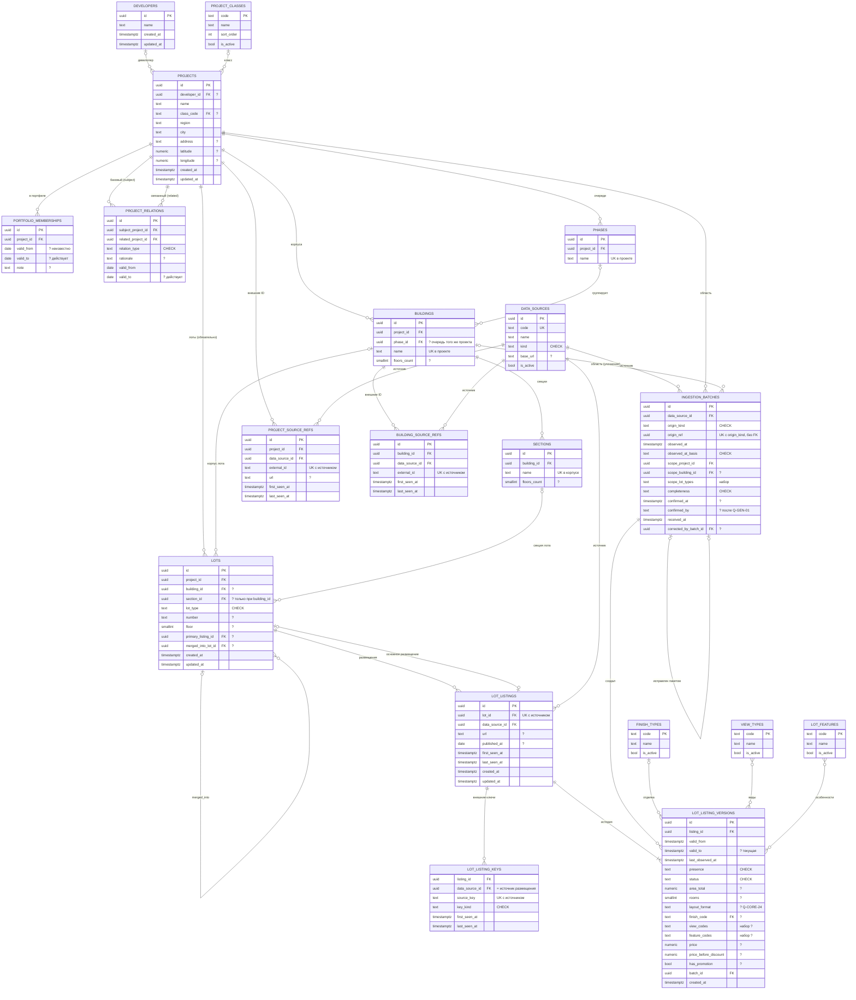

# Core / Projects & Lots — доменная модель (проект)

> **Статус: модель в целом утверждена (2026-09-15). Редакция 2 + принятые решения.**
> Документ описывает **целевую** модель. Что из неё реально реализовано в Core MVP и что
> сознательно отложено — [core-mvp.md](core-mvp.md). Принятые решения этапа реализации: цена
> и цена до скидки (п. 6.2, Q-CORE-15 закрыт), детализированные условия продаж не блокируют Core
> (п. 6.4, Q-CORE-10 — LATER), fuzzy matching не используется, неоднозначное сопоставление решает
> пользователь. Решения, которые оставались на подтверждение, собраны в
> [разделе 16](#16-решения-требующие-подтверждения), вопросы к бизнесу — в
> [open-questions.md](../requirements/open-questions.md) (классы BLOCKING / IMPORTANT / LATER).
> Принятые ADR: [ADR-0006](../decisions/0006-core-identity-and-source-references.md)
> (идентичность и сопоставление), [ADR-0007](../decisions/0007-lot-history-model.md) (история
> лота), [ADR-0008](../decisions/0008-mvp-document-import-ai-extraction.md) (импорт PDF с
> AI-извлечением в MVP).
>
> Связанный документ: [pdf-extraction.md](pdf-extraction.md) — входной сценарий MVP
> «PDF → AI-извлечение → проверка → подтверждение → Core».
>
> Источник требований — [исходное ТЗ](../requirements/source/tz-text.md). Уточнения из
> постановок этапа Module 1 отмечены **[уточнение 2026-09-15]**: единая модель рынка;
> конкурентность — отношение проектов; отсутствие лота ≠ продан; в MVP автоматический сбор с
> сайтов не входит, основной автоматизированный источник — PDF с проверкой пользователем.
>
> **Изменения редакции 2:** входной контракт Core рассчитан на подтверждённые пользователем
> импорты документов и на будущий автоматический сбор; «снимок предложения» заменён пакетом
> приёма (`IngestionBatch`); добавлены состояния сопоставления и явный выбор объекта
> пользователем; история допускает редкие и неупорядоченные по времени наблюдения
> (`last_observed_at` в версии, вставка в прошлое); различаются «значение неизвестно» и
> «источник явно показывает отсутствие».

## Содержание

1. [Назначение Core](#1-назначение-core)
2. [Scope / out of scope](#2-scope--out-of-scope)
3. [Терминология](#3-терминология)
4. [Единая модель рынка](#4-единая-модель-рынка)
5. [Сущности и иерархия](#5-сущности-и-иерархия)
6. [Модель Lot](#6-модель-lot)
7. [Идентичность, сопоставление и дедупликация](#7-идентичность-сопоставление-и-дедупликация)
8. [История лота](#8-история-лота)
9. [Источники, provenance и входной контракт](#9-источники-provenance-и-входной-контракт)
10. [Справочники и перечисления](#10-справочники-и-перечисления)
11. [Граница Core](#11-граница-core)
12. [Use cases и публичный контракт](#12-use-cases-и-публичный-контракт)
13. [ER-модель](#13-er-модель)
14. [Инварианты и правила](#14-инварианты-и-правила)
15. [Проверка на будущие источники и модули](#15-проверка-на-будущие-источники-и-модули)
16. [Решения, требующие подтверждения](#16-решения-требующие-подтверждения)
17. [Расхождения с ТЗ и документацией](#17-расхождения-с-тз-и-документацией)

---

## 1. Назначение Core

**Core / Projects & Lots** — центральный доменный модуль Realty Radar. Он обеспечивает
единое каноническое представление объектов рынка недвижимости, их структуры, базовых
характеристик, отношений и текущего/исторического состояния.

| Вопрос | Чем отвечает модель |
|---|---|
| Какие объекты существуют? | Developer, Project, Phase, Building, Section, Lot |
| Как они связаны? | иерархия размещения; отношения проектов (`ProjectRelation`); портфель компании (`PortfolioMembership`) |
| Каковы их базовые характеристики? | атрибуты сущностей и версии состояния лота в источнике |
| Каково их состояние сейчас? | текущая версия основного размещения лота |
| Каково было состояние на дату X? | версия, интервал которой содержит X, и давность её подтверждения |
| Откуда известны данные? | `DataSource`, внешние идентификаторы, размещения лота в источниках, пакеты приёма (`IngestionBatch`) со ссылкой на подтверждённый импорт |

Core независим от способа получения данных (PDF, ручной ввод, будущий сбор с сайтов),
AI-провайдеров, парсеров, способов анализа, UI и специализированной логики Floor Plans,
Location, Benchmark и Offer Analytics. Core **не является** общим хранилищем результатов
других модулей ([ADR-0004](../decisions/0004-module-boundaries.md)).

## 2. Scope / out of scope

### Входит в Core

- девелоперы и проекты (ЖК) — собственные и внешние, в одной модели;
- структура проекта: очереди, корпуса, секции;
- лоты всех типов (тип — атрибут; состав типов — Q-CORE-02);
- класс проекта (назначенный, Q-CORE-04);
- принадлежность проекта портфелю компании;
- отношения проектов: прямой конкурент, косвенный конкурент, референсный проект;
- реестр источников данных (идентичность источника, не способ получения);
- внешние идентификаторы, размещения лотов в источниках;
- детерминированный поиск кандидатов для сопоставления импортируемых объектов;
- приём **подтверждённых нормализованных** данных (ingestion) и история состояния;
- справочники базовых характеристик (класс, отделка, вид, особенности лота);
- контракт чтения (Go API и опубликованные представления).

### Не входит в Core

| Что | Где |
|---|---|
| Хранение PDF, вызов AI/LLM/Vision, OCR, промпты, анализ изображений, Extraction Result, проверка и исправление результатов извлечения пользователем, черновики импорта | Data Collection — компонент импорта документов ([pdf-extraction.md](pdf-extraction.md), ADR-0008) |
| Будущий автоматический сбор с сайтов: расписания, запуски, HTTP, парсинг, скриншоты, контроль качества | Data Collection (future scope) |
| Наблюдения как «что показал источник» со всеми доказательствами | Data Collection |
| Агрегаты, распределения, медианы, премии, динамика цен, стадия предложения, диапазоны этажей | Offer Analytics |
| Помещения, коэффициенты, тип и классификация планировки, похожие планировки, файлы планов | Floor Plans |
| Объекты деклараций, срезы, объёмы продаж | Project Declarations |
| Продуктовые характеристики, оценки, scoring | Product Benchmark |
| POI, расстояния, время в пути, барьеры | Location Analytics |
| Автоматическое вычисление типа конкурента по критериям | не Core, см. п. 4.4 |
| Пользователи, роли, аудит | не определено (Q-GEN-01) |

### Каналы поступления данных в MVP [уточнение 2026-09-15]

| Канал | Что поступает в Core | Как |
|---|---|---|
| Команды аналитика (UI) | проекты, девелоперы, структура, класс, портфель, отношения, источники | команды Core |
| Импорт PDF с AI-извлечением | подтверждённые пользователем данные лотов и структуры корпусов | Collection → `IngestObservationBatch` |
| Ручной ввод данных лотов | введённые пользователем данные | Collection (тот же сценарий проверки без документа) → `IngestObservationBatch` |
| Автоматический сбор с сайтов | — (future scope) | тот же контракт, `origin_kind = automated_collection` |

## 3. Терминология

Термины будут использоваться в коде Core. Синонимы не вводятся (lot ≠ unit ≠ apartment;
квартира — тип лота).

| Термин (код) | Русский термин | Определение |
|---|---|---|
| `Developer` | Девелопер | Участник рынка, от имени которого реализуется проект (уровень — Q-CORE-21) |
| `Project` | Проект, ЖК | Проект недвижимости независимо от его роли для компании |
| `Phase` | Очередь | Группа корпусов проекта. Необязательна |
| `Building` | Корпус | Здание (или отдельный объект, например паркинг) в составе проекта |
| `Section` | Секция | Часть корпуса. Необязательна |
| `Lot` | Лот | Канонический объект продажи: квартира, апартаменты, коммерческое помещение, кладовая, машино-место (состав — Q-CORE-02) |
| `DataSource` | Источник данных | Идентифицируемое происхождение сведений: сайт, канал документов (например, прайс-листы девелопера), ручной ввод. Пространство имён внешних идентификаторов |
| `LotListing` | Размещение лота | Лот в одном источнике: внешние ключи, URL, первое/последнее наблюдение, собственная история состояния |
| `LotListingVersion` | Версия размещения | Интервал, в течение которого состояние лота в источнике считается неизменным, с моментом последнего подтверждения |
| `LotState` | Состояние лота | Каноническое состояние на момент = версия основного размещения. Проекция, не таблица |
| `IngestionBatch` | Пакет приёма | Одна порция подтверждённых данных, принятая Core: источник, способ поступления, ссылка на импорт в Collection, момент, к которому относятся данные, область, полнота |
| `Observation` (в пакете) | Наблюдение | Нормализованный элемент пакета: «источник показал этот лот с такими значениями на момент T». Хранится в Collection; Core хранит только результат его применения |
| `MatchState` | Состояние сопоставления | Результат поиска кандидатов: `matched`, `possible_match`, `new`, `insufficient_identity` (п. 7.4) |
| `Presence` | Присутствие в предложении | Показывает ли источник лот: `listed` / `delisted`. Не равно статусу продаж |
| `LotStatus` | Статус лота | Статус продаж, **заявленный источником** (Q-CORE-07) |
| `PortfolioMembership` | Принадлежность портфелю | Факт, что проект в указанный период — проект компании |
| `ProjectRelation` | Отношение проектов | Направленное отношение базового проекта к другому: прямой конкурент, косвенный конкурент, референсный проект |
| `ProjectClass` | Класс проекта | комфорт+, бизнес, бизнес+, премиум, элит, делюкс (ТЗ п. 1; полнота — Q-CORE-04) |
| Extraction Result | Результат извлечения | Предварительный результат AI-извлечения из документа. Принадлежит Data Collection, **не является** данными Core |

---

## 4. Единая модель рынка

### 4.1. Один Project для всех ролей

**[уточнение 2026-09-15]** В одной модели хранятся собственные проекты компании и их объекты,
внешние проекты рынка, проекты для конкурентного сравнения и референсные проекты.

Отдельных сущностей `OurProject` / `CompetitorProject` нет. Объективной доменной причины для
разделения нет:

- у собственных и внешних проектов одинаковая структура и одинаковые базовые характеристики;
- аналитика ТЗ сравнивает их по одним измерениям (п. 2; п. 3 «сравнение цены с
  конкурентами»). Разделение потребовало бы объединять таблицы во всех запросах;
- роль — не свойство проекта: один проект — конкурент для одного проекта, референс для
  другого и не участвует в сравнении с третьим;
- роль меняется со временем (покупка проекта, завершение продаж).

Роль выражается двумя **независимыми** отношениями:

| Понятие | Сущность | Вопрос |
|---|---|---|
| A. Принадлежность портфелю компании | `PortfolioMembership` | «Это наш проект (в период P)?» |
| B. Отношение проектов | `ProjectRelation` | «Чем проект Y является для проекта X (в период P)?» |

Признак `competitor = true` не используется.

### 4.2. Собственные проекты: PortfolioMembership

**Предложение:** отдельная сущность принадлежности, а не атрибут проекта и не вывод из
девелопера.

| Поле | Тип | Обязательность | Смысл |
|---|---|---|---|
| `id` | uuid | да | |
| `project_id` | uuid → Project | да | |
| `valid_from` | date | нет | с какой даты проект в портфеле (null — неизвестно) |
| `valid_to` | date | нет | до какой даты (null — действует) |
| `note` | text | нет | основание |

| Альтернатива | Почему отклонена |
|---|---|
| Признак `is_own` в Project | Смешивает рыночный факт с внутренней классификацией компании; теряет период (покупка/продажа проекта) |
| Вывод «наш = девелопер нашей группы» | Разные юрлица-застройщики, совместные проекты, частичное участие; ошибка в структуре группы молча меняет портфель |
| Отдельная сущность OurProject | См. п. 4.1 |

Открыто (Q-CORE-20): уровень принадлежности (проект или очереди/корпуса), совместные проекты,
нужна ли история, несколько бизнес-единиц. Модель расширяется (`phase_id`/`building_id`,
`portfolio_id`) без изменения Project.

### 4.3. Отношения проектов: ProjectRelation

ТЗ (п. 1, «Как определять конкурентов?») задаёт три вида: **прямые конкуренты**,
**косвенные конкуренты**, **референсные проекты**. Других видов в требованиях нет, и они не
вводятся. Классы (комфорт+ … делюкс) в ТЗ названы «классами конкурентов», но по смыслу это
класс проекта («относятся к сопоставимому классу»). Класс хранится в Project.

| Кандидат | Решение | Обоснование |
|---|---|---|
| source project | **`subject_project_id`** — базовый проект | Отношение **направленное**: «Y — конкурент/референс *для* X». Референс односторонний по определению; косвенная конкуренция асимметрична («перетягивать спрос за счёт более низкой цены»). Зеркальная запись не создаётся |
| target project | **`related_project_id`** | |
| relation type | **`relation_type`**: `direct_competitor` / `indirect_competitor` / `reference` | три вида из ТЗ; код опирается на смысл → `text` + `CHECK` |
| rationale | **`rationale`** — text, необязательно | ТЗ перечисляет критерии как определения, но не требует фиксировать их по каждой связи. Структурированные критерии — кандидат после Q-CORE-19 |
| valid_from / valid_to | **оставить**, `date` | набор конкурентов меняется; без периода «сравнение с конкурентами на дату X» строится по нынешнему набору. Нужна ли история — Q-CORE-19 |
| кто назначил, способ назначения | не добавлять | нет пользователей (Q-GEN-01) и автоматического назначения (Q-CORE-06) |
| вес / сила | не добавлять | в ТЗ отсутствует |

Правила:

- `subject_project_id ≠ related_project_id`;
- периоды одной тройки (subject, related, type) не пересекаются;
- `direct_competitor` и `indirect_competitor` для одной пары в один период взаимоисключающие —
  **требует подтверждения** (Q-CORE-19);
- `reference` может сосуществовать с конкурентным отношением;
- базовым может быть любой проект; ограничение «только проект портфеля» — после Q-CORE-19;
- смена типа = закрытие отношения + новое отношение.

Пример **[уточнение 2026-09-15]**: внешний проект Y — `direct_competitor` для A,
`indirect_competitor` для B, `reference` для C, с D не связан — три записи и отсутствие
четвёртой.

### 4.4. Автоматическое определение конкурентов

Критерии ТЗ используют цены, локацию, стадию, продукт и ЦА. Это данные Offer Analytics,
Location и Benchmark. Вычисление **кандидатов** в Core потребовало бы зависимости Core от
других модулей (запрещено ADR-0004). Core хранит только **утверждённые** отношения.
Автоматический подбор (Q-CORE-06, LATER) — задача другого модуля или агрегирующего сценария,
который выбирается по ADR-0004.

---

## 5. Сущности и иерархия

### 5.1. Итоговый состав сущностей

| Сущность | Нужна? | Решение |
|---|---|---|
| Developer | да | фильтр «по девелоперу» (п. 2), «более сильный бренд» (п. 1) |
| Project | да | центральная сущность |
| ProjectClass (справочник) | да | п. 1, фильтр п. 2 |
| PortfolioMembership | да | собственные проекты [уточнение 2026-09-15] |
| ProjectRelation | да | прямые / косвенные / референсные (п. 1) |
| Phase | да, необязательный уровень | «в проекте, корпусе и очереди» (п. 1), фильтр п. 2 |
| Building | да | корпус (п. 3), распределение по корпусам (п. 1) |
| Section | да, необязательный уровень | секция (п. 3); альтернатива — п. 5.3 |
| Lot | да | лот (п. 3), типы лотов (п. 6) |
| DataSource | да | происхождение данных |
| ProjectSourceRef, BuildingSourceRef | да | внешние идентификаторы структурных объектов |
| LotListing + LotListingKey | да | лот в источнике; внешние ключи необязательны: в PDF их обычно нет |
| LotListingVersion | да | история состояния ([ADR-0007](../decisions/0007-lot-history-model.md)) |
| IngestionBatch | да — **недостающая** в исходном списке | происхождение канонических данных, момент, к которому они относятся, область и полнота поступления |
| LotState | проекция | каноническое состояние = версия основного размещения |
| Справочники отделки, вида, особенностей | да | п. 3 (Q-CORE-08) |
| SalesTerm (рассрочка / ипотека / акции) | **не в первой итерации** | структура и уровень неизвестны; не блокирует Core MVP, модель — следующий этап / Offer Analytics — Q-CORE-10 (LATER; ранее BLOCKING для этой части), п. 6.4 |
| DeveloperLegalEntity (застройщик, ИНН) | нет | уровень девелопера — Q-CORE-21; декларации — Declarations |
| District (район) | нет | смысл не определён (Q-CORE-13) |
| Document, ExtractionRun, ImportReview | **не Core** | Data Collection ([pdf-extraction.md](pdf-extraction.md)) |
| Планировка / FloorPlan, помещения | **не Core** | Floor Plans; извлечённые факты о помещениях до его реализации остаются в Collection |
| Сущность «цена» или «прайс-лист» | нет | цена — атрибут версии; прайс-лист — документ в Collection |

### 5.2. Иерархия

```
Developer (0..1) ─── Project ─┬── Phase (0..N, необязательно)
                              │      └── группирует Building (0..N)
                              ├── Building (0..N) ── Section (0..N, необязательно)
                              └── Lot (0..N)
                                    ├── building_id  (nullable)
                                    └── section_id   (nullable, только при building_id)
```

Иерархия **не является строгой цепочкой**. Обязательна только связь **Lot → Project**.

| Уровень | Всегда существует? | Реальные сценарии | Решение |
|---|---|---|---|
| Developer | почти всегда | в документе нет девелопера; совместные проекты | `Project.developer_id` nullable, один девелопер; совместные — Q-CORE-21 |
| Project | да | — | обязателен для корпуса и лота |
| Phase | нет | однофазные проекты; документ не называет очередь; секции одного корпуса в разных очередях | `Building.phase_id` nullable; очередь на уровне секции — Q-CORE-01 (расширение без изменения модели) |
| Building | для квартир — практически всегда | подземный паркинг под несколькими корпусами; стилобат с коммерцией; документ не указывает корпус | `Lot.building_id` nullable |
| Section | нет | корпус из одной секции; документ не показывает секцию | `Lot.section_id` nullable; Section всегда в Building |

| Связь | Cardinality | Обязательность |
|---|---|---|
| Developer — Project | 1 : 0..N | у проекта 0..1 девелопер |
| Project — Phase | 1 : 0..N | очередь — ровно в одном проекте |
| Project — Building | 1 : 0..N | корпус — ровно в одном проекте |
| Phase — Building | 0..1 : 0..N | корпус — не более чем в одной очереди |
| Building — Section | 1 : 0..N | секция — ровно в одном корпусе |
| Project — Lot | 1 : 0..N | лот — ровно в одном проекте |
| Building — Lot, Section — Lot | 0..1 : 0..N | необязательно |
| Lot — LotListing | 1 : 0..N | размещение — ровно одного лота; не более одного на источник |
| LotListing — LotListingVersion | 1 : 1..N | ровно одна текущая версия |
| LotListing — LotListingKey | 1 : 0..N | ключ принадлежит одному размещению |
| IngestionBatch — LotListingVersion | 1 : 0..N | версия создана ровно одним пакетом |

Выводы:

- **Очередь лота не хранится в лоте** — выводится через корпус. Хранение создало бы вторую,
  противоречивую истину.
- **`Lot.project_id` хранится явно**: корпус может быть неизвестен. Согласованность — инвариант.
- **Объект не принадлежит нескольким структурам одновременно.** Корпус в нескольких очередях
  моделируется очередью на уровне секции (Q-CORE-01).
- **Внешние идентификаторы:** Project, Building, Lot (если источник их даёт). Phase и Section
  сопоставляются по названию в пределах родителя.

### 5.3. Section: сущность или атрибут лота

| Вариант | Плюсы | Минусы |
|---|---|---|
| Атрибут `section_label` в лоте | проще; показателей по секциям ТЗ не требует | название нормализуется в каждом лоте; некуда положить этажность и внешний ID секции |
| **Сущность Section (выбрано)** | одно место для названия, этажности и внешнего ID | ещё одна таблица и сопоставление по названию |

Этажность секций одного корпуса различается, а границы «нижних / средних / верхних» этажей
(Q-OFFER-01) могут от неё зависеть.

### 5.4. Атрибуты структурных сущностей (первая итерация)

| Сущность | Атрибуты | История |
|---|---|---|
| Developer | `name` | нет |
| Project | `name`, `developer_id?`, `class_code?`, `region`, `city`, `address?`, `latitude?`, `longitude?` | нет; история класса — Q-CORE-04 |
| Phase | `project_id`, `name` | нет |
| Building | `project_id`, `phase_id?`, `name`, `floors_count?` | нет |
| Section | `building_id`, `name`, `floors_count?` | нет |

**Кандидаты, не включённые до ответа:** срок сдачи (уровень, формат, история переносов —
Q-CORE-12); район (Q-CORE-13); стадия реализации (Q-CORE-30); регион и город как справочник
(Q-GEN-03).

Структурные сущности хранят **текущие значения** без версий. Point-in-time по лотам полный, по
атрибутам проекта — нет. При подтверждённой потребности добавляется история конкретного
атрибута. Изменения структурных атрибутов, найденные в документе, применяются только явным
решением пользователя при проверке (п. 9.4).

---

## 6. Модель Lot

### 6.1. Разделение: Lot, LotListing, LotListingVersion

| Уровень | Что хранит | Как меняется |
|---|---|---|
| `Lot` | канонический ID, тип, размещение: проект, корпус, секция, этаж, номер | исправлениями; не версионируется |
| `LotListing` | лот в одном источнике: внешние ключи, URL, дата публикации, первое и последнее наблюдение | при приёме |
| `LotListingVersion` | состояние в источнике: присутствие, статус, площадь, комнатность, отделка, вид, особенности, цены, акция | новая версия при изменении |

Размещение (этаж, номер, корпус) описывает физический объект. Его изменение — исправление
данных или перенумерация условного номера после обмеров, а не событие рынка. Площадь и
комнатность версионируются: они меняются как рыночные сведения (обмеры БТИ, объединение лотов,
перемаркировка формата), и цена за м² на дату X должна считаться от площади на дату X.

### 6.2. Полный перечень характеристик лота

Категории: **I** — identity; **S** — relatively static; **T** — temporal / changeable;
**C** — calculated; **SRC** — source-specific; **O** — optional (может отсутствовать в источнике).

| # | Характеристика | ТЗ | Где в модели | Категории | Хранится |
|---|---|---|---|---|---|
| 1 | Внутренний ID | — | `Lot.id` (UUIDv7) | I | да |
| 2 | External ID | п. 3 «ID лота» | `LotListingKey.source_key` | I, SRC, O | да, если источник даёт; в PDF обычно нет |
| 3 | Источник | — | `LotListing.data_source_id` | I, SRC | да |
| 4 | Тип лота | п. 6 | `Lot.lot_type` | I | да |
| 5 | ЖК | п. 3 | `Lot.project_id` | I | да, обязательно |
| 6 | Очередь | пп. 1–2 | через `Building.phase_id` | C | нет в лоте |
| 7 | Корпус | п. 3 | `Lot.building_id` | I (часть ключа сопоставления), S, O | да |
| 8 | Секция | п. 3 | `Lot.section_id` | S, O | да |
| 9 | Этаж | п. 3 | `Lot.floor` | S, O | да; многоуровневые — Q-CORE-28 |
| 10 | Номер квартиры / лота | п. 3 | `Lot.number` (text) | I (часть ключа), S, O | да |
| 11 | Количество комнат | п. 3 | `rooms` + `layout_format` в версии | S (версионируется), O | да; студии, евроформаты — Q-CORE-24 |
| 12 | Общая площадь | п. 3 | `area_total` в версии | S (версионируется), O | да; вид площади — Q-CORE-09 |
| 13 | Цена | п. 3 «цена за лот» | `price` в версии — **актуальная цена предложения лота на момент наблюдения** (решение 2026-09-15, Q-CORE-15) | T, O | да |
| 14 | Цена за м² | п. 3 | `price / area_total` | C | **нет** (п. 6.3) |
| 15 | Отделка | п. 3 | `finish_code` в версии | T, O | да; варианты с разной ценой — Q-CORE-23 |
| 16 | Вид из окон | п. 3 | набор кодов в версии | S (версионируется), O | да (Q-CORE-08) |
| 17 | Терраса / особенности | п. 3 | набор кодов в версии | S (версионируется), O | да (Q-CORE-08) |
| 18 | Статус | п. 3 | `status` в версии | T | да; `unknown` допустим (Q-CORE-07) |
| 19 | Присутствие в предложении | п. 3 «отслеживать во времени», [уточнение] | `presence` в версии | T | да |
| 20 | Размер скидки | п. 3 | `price_before_discount − price` (сумма и процент вычисляются при необходимости) | C | **нет** (решение 2026-09-15) |
| 21 | Цена до скидки | п. 3 | `price_before_discount` в версии | T, O | да |
| 22 | Цена после скидки | п. 3 | = `price` (актуальная цена предложения); `price_before_discount` — базовая / предыдущая цена до **явно указанной** источником скидки. Если скидка из источника однозначно не следует — `price_before_discount = null`; из предположений не выводится (решение 2026-09-15) | T, O | да |
| 23 | Рассрочка | п. 3 | — | T, O | **не в Core MVP**; структурированная модель — следующий этап / Offer Analytics (Q-CORE-10, LATER) |
| 24 | Ипотека | п. 3 | — | T, O | то же |
| 25 | Срок бронирования | п. 3 | — | T, O | смысл неизвестен — Q-CORE-22 |
| 26 | Акция | п. 3 «наличие акции» | `has_promotion` в версии | T, O | да; содержание — Q-CORE-10 |
| 27 | URL источника | п. 3 | `LotListing.url` | SRC, T, O | да, если есть (сайт); у PDF — ссылка на документ через пакет приёма (п. 9) |
| 28 | Скриншот | п. 3 | — | SRC | **нет** в Core; доказательство — Collection (для PDF — сам документ и evidence извлечения) |
| 29 | Дата публикации | п. 3 | `LotListing.published_at` | SRC, O | да, если источник даёт (Q-CORE-11) |
| 30 | First seen | п. 3 | `LotListing.first_seen_at`; для лота — минимум | служебная; C для лота | в размещении — да |
| 31 | Last seen | п. 3 «дата последнего обновления» | `LotListing.last_seen_at`; `last_observed_at` версии | служебная | да; смысл «обновления» — Q-CORE-16 |

### 6.3. Что не хранится

| Величина | Почему не хранится | Где вычисляется |
|---|---|---|
| Цена за м² | Выводится из цены и площади. Хранение даёт второе значение, которое расходится с первым при исправлении. Значение, указанное в документе, — сигнал для проверки в Collection (сравнение с расчётным), а не каноническое значение. Если источники считают от приведённой площади и не публикуют её (Q-CORE-09), решение пересматривается | Опубликованное представление Core; агрегаты — Offer Analytics |
| Размер скидки | Выводится из двух цен. Если источник показывает только процент или только одну цену, `price_before_discount = null` (решение 2026-09-15) | Представление Core |
| Очередь лота | Через корпус | Представление Core |
| First seen лота | `min(first_seen_at)` по размещениям; ломается при слиянии | Представление Core |
| «Доступен на дату» | `presence = listed AND status = available` | Запрос Core |
| Срок экспозиции, изменение цены за период, премии, диапазон этажей, стадия предложения, доля евроформатов | Аналитика | Offer Analytics |
| Евроформат по геометрии, жилая площадь по распознаванию, типы помещений | Анализ | Floor Plans |

Правило: **Core хранит сведения, заявленные источником и подтверждённые, и не хранит то, что
однозначно вычисляется из хранимого.** Производные величины одного лота Core публикует в
представлении с одной формулой; агрегаты — не Core.

### 6.4. Условия продаж

ТЗ перечисляет рассрочку, ипотеку, срок бронирования и акцию среди «данных по каждому лоту».
На практике условия часто действуют на проект или корпус, бывают условными («скидка при 100 %
оплате») и описываются текстом. В версии лота смена одной акции создавала бы новые версии для
тысяч лотов при неизвестной структуре полей.

Поэтому условия **не входят в версию лота**. Кандидат после Q-CORE-10 и Q-CORE-22 — отдельная
сущность условий продаж с областью (проект / корпус / лот), типом, источником и периодом.
Добавление не меняет модель Lot. Текст условий, найденный в PDF, остаётся в Extraction Result
(Collection).

**Решение 2026-09-15:** детализированные условия продаж (рассрочка, ипотека, условия
бронирования, детали акций, другие финансовые условия) **не блокируют Core MVP**. Их
структурированная модель переносится на следующий этап / Offer Analytics. Если такие данные
раньше извлекаются из PDF, они остаются в Extraction Result до появления утверждённой модели.
Признак `has_promotion` — кандидат целевой модели. В Core MVP он не реализован
([core-mvp.md](core-mvp.md)).

### 6.5. Типы лотов

Лот — общая сущность для всех типов (A-11). Характеристики квартир (комнатность, отделка, вид)
необязательны. Подтипы-таблицы не вводятся: в ТЗ нет атрибутов, различающих типы, кроме самого
типа (п. 6). Если у машино-мест или кладовых появятся свои атрибуты, добавляется расширение по
типу, а базовая сущность не меняется. **MVP не расширяется** на нежилые типы: их поддержка в
импорте — после Q-CORE-02.

---

## 7. Идентичность, сопоставление и дедупликация

Решение — [ADR-0006](../decisions/0006-core-identity-and-source-references.md) (Принят).

### 7.1. Два вида идентификаторов

| | Канонический ID Realty Radar | Идентичность во внешнем источнике |
|---|---|---|
| Где | `Lot.id`, `Project.id`, … | `LotListingKey`, `ProjectSourceRef`, `BuildingSourceRef` |
| Формат | UUIDv7, генерирует приложение | строка источника или ключ, построенный Collection |
| Стабильность | не меняется, не переиспользуется, не выводится из внешних данных | может меняться, отсутствовать, повторяться в разных источниках |
| Уникальность | глобальная | в пределах `(data_source_id, key)` |
| Используют | все модули (FK на Core) | сопоставление при приёме |

Extraction Result и черновики импорта **не содержат канонических ID** до шага сопоставления.
Выбор объекта Core — решение проверки (п. 7.4), а не результат AI.

### 7.2. Ключи сопоставления

Сопоставление опирается только на явные идентифицирующие сведения:

| Ключ | Состав | Надёжность |
|---|---|---|
| **K1 — ключ источника** | `(data_source_id, source_key)`; `source_key` — ID лота в источнике (`native`) или детерминированный ключ, построенный адаптером Collection (`derived`) | высокая для `native`, зависит от адаптера для `derived` |
| **K2 — ключ размещения** | `(project_id, building_id, lot_type, number)`, если корпус и номер известны; `(project_id, lot_type, number)`, если у проекта нет корпусов | средняя: номера бывают условными, нумерация — по секциям |
| Описательные атрибуты | этаж, площадь, комнатность, цена | **не ключ**. Используются только как подсказка расхождений при проверке |

Fuzzy matching (похожая площадь, этаж, цена, похожее название) **не используется** для
установления идентичности (Q-CORE-03).

### 7.3. Минимальная идентичность нового лота

Новый канонический лот создаётся, только если известно: проект, тип лота и K1 или K2.
Конкретный минимальный набор — **предложение**, требует подтверждения (Q-PDF-13). Лот без номера
и без ключа источника (например, «типовая планировка 2А, 64,3 м²» без привязки к квартирам) —
**не лот Core**. Такие сведения остаются в Extraction Result (кандидат для Floor Plans).

### 7.4. Состояния сопоставления

Core предоставляет **детерминированный поиск кандидатов** (`FindMatchCandidates`). Результат —
состояние и список кандидатов с объяснением правила:

| Состояние | Когда (для лота, в пределах выбранного проекта) | Действие по умолчанию при проверке |
|---|---|---|
| `matched` | точное совпадение K1; или K2 с ровно одним кандидатом | предвыбран кандидат; пользователь может изменить |
| `possible_match` | несколько кандидатов по K2; номер совпал, но корпус в документе не указан; совпадение K1 при расхождении размещения (другой номер или корпус) | пользователь выбирает кандидата, «новый» или исключает элемент |
| `new` | минимальная идентичность есть, кандидатов нет | предлагается создать новый лот |
| `insufficient_identity` | минимальной идентичности нет | нельзя создать; можно вручную указать существующий лот, дополнить идентичность или исключить элемент |

Для проекта: `matched` — точная `ProjectSourceRef`; `possible_match` — совпадение
нормализованного названия (регистр, пробелы, кавычки; правила нормализации технические и
перечисляются при реализации); `new` — название есть, кандидатов нет; `insufficient_identity`
— нет названия. **В MVP проект всегда выбирает пользователь**; поиск только подсказывает.

Для корпуса и секции (в пределах выбранного проекта или корпуса): `matched` — ссылка источника
или точное нормализованное название; `new` — название есть, совпадений нет; «не указан» —
лот без корпуса или секции.

**Кто решает:**

| Канал | Кто принимает решение о сопоставлении |
|---|---|
| Импорт PDF, ручной ввод (MVP) | пользователь при проверке; в пакет приёма передаётся **явная цель**: существующий ID или «создать новый» |
| Будущий автоматический сбор | Core по K1 автоматически; `new` — создание при минимальной идентичности; остальные состояния — отказ элемента с причиной, разбор в Collection |

При приёме Core **повторно проверяет** решение: цель существует и не слита; для «создать новый»
по K1/K2 не появился кандидат, пока шла проверка. Иначе элемент отклоняется с причиной
`match_conflict`, и импорт возвращается на проверку.

### 7.5. Сценарии

| Сценарий | Поведение |
|---|---|
| External ID стабилен | K1 → `matched`; изменения → версии |
| External ID изменился | K1 не найден; K2 даёт `matched`/`possible_match`; при подтверждении новый ключ добавляется к размещению |
| External ID отсутствует (типично для PDF) | K2 и решение пользователя |
| Нет номера квартиры | `insufficient_identity`, если нет K1 |
| Только часть идентичности (номер без корпуса) | `possible_match` с кандидатами по проекту |
| Лот в нескольких источниках | один лот, несколько размещений; межисточниковая связь — решение пользователя (MVP) или правила после Q-CORE-03 |
| Изменился URL | атрибут размещения, не идентичность |
| Изменился номер при стабильном K1 | тот же лот; расхождение показывается при проверке; `Lot.number` обновляется только подтверждённым исправлением |
| Данные разных источников противоречат | каждое размещение хранит свою историю; каноническое — основное размещение (Q-CORE-18) |
| Агрегатор с несколькими объявлениями на лот | не поддерживается моделью «одно размещение на источник» — Q-CORE-14 (LATER, вместе с автоматическим сбором) |

### 7.6. Слияние и перенос

- `MergeLots(survivor, duplicate)`: размещения переносятся; два размещения из одного источника
  объединяются, только если их интервалы не пересекаются. Дубликат не удаляется:
  `merged_into_lot_id`. Контракт публикует слияния для перевода ссылок в других модулях.
- `ReassignListing(listing, lot)` — исправление ошибочного сопоставления.
- `MergeBuildings`, `MergeSections` — дубликаты структуры.
- Разделение слитого лота и переигрывание истории — LATER (Q-CORE-27).

---

## 8. История лота

Решение — [ADR-0007](../decisions/0007-lot-history-model.md) (Принят), уточняет ADR-0003 п. 2.

### 8.1. Цепочка

```
Data Collection                                   Core
─────────────────────────────────────────         ──────────────────────────────────────────
PDF → Extraction Result → проверка → подтверждённый импорт ─┐
ручной ввод → проверка → подтверждённый импорт ─────────────┼─► IngestionBatch (источник, момент,
(future) запуск сбора → наблюдения → нормализация ──────────┘      область, полнота, ссылка на импорт)
                                                                    │
                                                                    ▼
                                                  LotListing (лот × источник): first/last seen
                                                                    │
                                                                    ▼
                                                  LotListingVersion [valid_from, valid_to)
                                                  + last_observed_at
                                                                    │ основное размещение
                                                                    ▼
                                                  LotState (проекция на момент)
```

| Понятие | Что это | Где |
|---|---|---|
| Документ, Extraction Result, решения проверки | Предварительные данные и доказательства | Collection |
| Подтверждённый импорт (наблюдения пакета) | Неизменяемая запись того, что подтвердил пользователь и что отправлено в Core | Collection |
| `IngestionBatch` | Факт приёма: источник, способ поступления, ссылка на импорт, момент данных, область, полнота | Core |
| `LotListingVersion` | Интервал неизменного состояния в источнике и момент последнего подтверждения | Core |
| `LotState` | Состояние лота на момент | Core, проекция |

ADR-0003 оставлял текущее состояние на выбор: «версия с `valid_to IS NULL` или отдельная
таблица». Выбрано первое — отдельной таблицы текущего состояния нет.

### 8.2. Момент данных (`observed_at`)

Пакет несёт момент, **к которому относятся данные**, и основание этого момента:

| Основание (`observed_at_basis`) | Когда |
|---|---|
| `document_date` | в документе явно указана дата актуальности («цены на 01.09.2026»), пользователь подтвердил |
| `received_date` | даты в документе нет; дата получения документа, указанная пользователем |
| `upload_time` | даты нет, пользователь не указал иное |
| `entry_time` | ручной ввод |
| `collection_time` | будущий автоматический сбор |

Какая дата верна для PDF — Q-PDF-03. Основание хранится, чтобы аналитика могла учитывать
точность.

### 8.3. Полнота пакета и исчезновение

Пакет имеет **область** (проект; необязательно корпус; набор типов лотов) и **полноту**:

- `complete` — в пакете все лоты области, которые источник показывает на момент данных. Для
  документа это утверждает **пользователь** («прайс-лист содержит все лоты в продаже по
  корпусу 2»), для будущего сбора — Collection;
- `partial` — только часть. **Значение по умолчанию для документов.**

Отсутствие лота учитывается **только** в `complete`-пакете, только для размещений того же
источника в области, только если момент пакета не раньше текущей версии размещения, и только
после порога промахов (Q-CORE-17). Нужно ли вообще выводить исчезновение из PDF — Q-PDF-06.

### 8.4. Различение ситуаций

| # | Ситуация | Что приходит в Core | Что делает Core |
|---|---|---|---|
| 1 | Источник не показал лот в полном перечне | `complete`-пакет без элемента | промах; после порога — версия `presence = delisted`; статус не меняется |
| 2 | Лот снят с продажи | как (1) или явный статус | (1) — `delisted`; явный статус — только из источника (Q-CORE-07) |
| 3 | Источник недоступен / документ не загружен | ничего | ничего; давность видна по `last_observed_at` |
| 4 | Ошибка извлечения или парсера | ничего (импорт не подтверждён) или `partial` | как (3) |
| 5 | Лот забронирован | элемент со статусом «забронирован» | версия `status = reserved` |
| 6 | Лот продан | элемент со статусом «продан» | версия `status = sold`; из отсутствия не выводится [уточнение 2026-09-15] |
| 7 | Лот снова появился | элемент после `delisted` | версия `presence = listed`; `first_seen_at` не меняется |
| 8 | Документ лишь частично перечисляет лоты | `partial`-пакет | исчезновение не выводится |

### 8.5. Неизвестно ≠ отсутствует

Каждое версионируемое значение в элементе пакета передаётся в одном из трёх состояний:

| Состояние | Смысл | Влияние на версию |
|---|---|---|
| `value` | источник показал значение | сравнивается с текущим |
| `unknown` | источник этого не сообщает (в документе нет сведений) | **значение не меняется**, переносится из версии |
| `absent` | источник явно показывает отсутствие (колонка «старая цена» пуста в прайс-листе со скидками; «акций нет») | значение становится пустым; это изменение |

`not_found` из Extraction Result по умолчанию превращается в `unknown`. `absent` задаётся только
явным решением (пользователь при проверке или правило адаптера сбора). Иначе PDF без раздела
«скидки» стирал бы ранее известную скидку. Ограничение: перенесённые значения не помечаются
отдельно — их подтверждённость на момент известна только по версии в целом.

### 8.6. Когда создаётся новая версия

Новая версия создаётся, если отличается хотя бы одно версионируемое значение (с учётом
`unknown`): `presence`, `status`, `area_total`, `rooms`, `layout_format`, `finish_code`, виды,
особенности, `price`, `price_before_discount`, `has_promotion`.

Не создают версию: подтверждение без изменений (растёт `last_observed_at`), URL, дата
публикации, внешний ключ, размещение лота (исправление `Lot`), повторный приём того же импорта.
Сравнение точное, без допусков. При `delisted` атрибуты переносятся из предыдущей версии, поэтому
запросы «предложение на дату» фильтруют по `presence`.

### 8.7. Семантика времени и неупорядоченные наблюдения

- Версия: `[valid_from, valid_to)`, `valid_from` — момент первого наблюдения значений,
  `last_observed_at` — момент последнего наблюдения, подтвердившего эти значения,
  `valid_to` — `valid_from` следующей версии или `NULL` (текущая).
- Между `last_observed_at` и `valid_to` значения **не подтверждены**: при редких PDF это может
  быть месяц. Представления отдают `last_observed_at`, чтобы аналитика видела давность.
- Состояние на момент T: `valid_from ≤ T < coalesce(valid_to, +∞)`. На бизнес-дату D — на конец
  дня D по Europe/Moscow (A-07, подтвердить — Q-CORE-26).
- Модель не битемпоральная: «что система знала на дату» не хранится.

**Применение наблюдения с моментом t к размещению** (повторный импорт старого PDF — нормальный
сценарий):

| Случай | Действие |
|---|---|
| версий нет | версия `[t, ∞)`, `last_observed_at = t` |
| t позже или равно началу текущей версии, значения равны | `last_observed_at = max(…, t)` |
| t позже `last_observed_at` текущей версии, значения отличаются | текущая закрывается в t, открывается новая |
| t раньше первой версии | равны — первая версия расширяется назад (`valid_from = t`); отличаются — новая версия `[t, valid_from первой)` |
| t внутри версии v, значения равны | `last_observed_at(v) = max(…, t)` |
| t внутри v, значения отличаются, t позже `last_observed_at(v)` | v делится: `v.valid_to = t`, новая `[t, прежний v.valid_to)` |
| t внутри v, значения отличаются, t не позже `last_observed_at(v)` | противоречие с более поздним подтверждением — элемент отклоняется (`history_conflict`), разбор вручную; переигрывание истории — LATER (Q-CORE-27) |

`first_seen_at` / `last_seen_at` размещения — минимум и максимум моментов положительных
наблюдений. Выводить отсутствие из неупорядоченных (более ранних) `complete`-пакетов нельзя.

### 8.8. Каноническое состояние

- `Lot.primary_listing_id` — основное размещение; каноническая история лота — его версии.
- В первой итерации основным становится размещение, через которое создан лот. Правило выбора —
  Q-CORE-18. Смена основного размещения пересчитывает проекцию; история источников не теряется.

### 8.9. Идемпотентность и исправления

- Пакет идемпотентен по `(origin_kind, origin_ref)`; применяется атомарно.
- **Ошибочно подтверждённые данные** (Q-PDF-11). Предложение — операция `CorrectBatchData`:
  исправленные значения заменяют значения версий, созданных пакетом, **без новой версии**
  (исправление ≠ событие рынка). Соседние версии с совпавшими значениями объединяются. Пакет
  получает ссылку на корректирующий пакет. Полный отзыв пакета с переигрыванием истории — LATER.

### 8.10. Запросы, которые обеспечивает модель

| Вопрос | Как отвечает модель |
|---|---|
| Доступные лоты на дату X | версии основных размещений на X: `listed` и `available` (+ давность `last_observed_at`) |
| Цена лота на дату X | `price` версии на X |
| Изменение цены | сравнение версий на две даты (показатель — Offer Analytics) |
| Появление / исчезновение скидки | смена `price_before_discount` между значением и пустым (только при `absent`) |
| Изменение статуса | `valid_from` версии со сменой `status` |
| Исчезновение / повторное появление | версии `delisted` → `listed` |
| Предложение конкурента на дату | лоты проектов из `ProjectRelation` на дату × версии на дату |
| Насколько достоверно состояние на дату | `last_observed_at` версии; пакеты области и их полнота |

---

## 9. Источники, provenance и входной контракт

### 9.1. DataSource

`DataSource` — **идентичность** происхождения сведений, а не способ получения.

| Поле | Смысл |
|---|---|
| `code`, `name` | стабильный код и название |
| `kind` | `document_channel` (например, «прайс-листы девелопера X»), `manual`, `website` (future), `aggregator` (future; Q-CORE-14) |
| `base_url` | необязательно |
| `is_active` | источник больше не используется, история сохраняется |

Для документов источник — **канал**, а не отдельный файл. Иначе каждый PDF создавал бы новое
размещение, и история по лоту не складывалась бы. Источник выбирает пользователь при проверке
импорта. Как классифицировать происхождение PDF — Q-PDF-07.

Не в Core: настройки сбора, AI-провайдер, промпты, файлы, расписания.

### 9.2. Происхождение канонических данных

| Вопрос | Ответ |
|---|---|
| Из какого источника данные о лоте | `LotListing.data_source_id` |
| Каким способом получены | `IngestionBatch.origin_kind`: `document_import`, `manual_entry`, `automated_collection` |
| Из какого документа / импорта | `IngestionBatch.origin_ref` → подтверждённый импорт в Collection → документ и Extraction Result |
| На какой момент данные | `IngestionBatch.observed_at` + `observed_at_basis` |
| Когда подтверждены и приняты | `IngestionBatch.confirmed_at`, `received_at` |
| Кто подтвердил | `confirmed_by` — после появления пользователей (Q-GEN-01); до этого пусто |
| Какой источник сообщил конкретные значения | версия → пакет. Значения одной версии — от одного источника |
| AI извлёк или пользователь исправил / ввёл значение | **в Collection**: решения проверки по каждому полю (п. 9.4, [pdf-extraction.md](pdf-extraction.md)). В Core не дублируется |
| Где в документе значение | в Collection: evidence Extraction Result (страница, текст, область) |

Провенанс в Core — на уровне пакета и версии, без аудита по полям. Полевой провенанс
(«AI извлёк» / «пользователь подтвердил» / «пользователь исправил») хранится там, где
создаётся, — в Collection.

### 9.3. Граница Data Collection ↔ Core

| Ответственность | Collection | Core |
|---|---|---|
| Хранение PDF, запуск AI-извлечения, AI-адаптер, промпты | ✔ | |
| Extraction Result, валидация схемы, бизнес-проверки-предупреждения | ✔ | |
| Черновик импорта, проверка и исправление пользователем, решения по полям | ✔ | |
| Сопоставление значений с кодами справочников Core | ✔ | справочники |
| Поиск кандидатов сопоставления | вызывает, показывает | ✔ (детерминированно) |
| Решение о сопоставлении (MVP) | ✔ (пользователь) | проверяет при приёме |
| Неизменяемая запись подтверждённого импорта | ✔ | |
| Создание проекта, изменение профиля проекта | вызывает команды Core | ✔ |
| Приём пакета, размещения, версии, присутствие, first/last seen | | ✔ |
| Слияния, основное размещение | | ✔ |
| Будущий сбор с сайтов: запуски, наблюдения, полнота запуска, контроль качества | ✔ | |

Collection **не пишет в схему `core`**.

### 9.4. Входной контракт: `IngestObservationBatch`

Один контракт для импорта документов, ручного ввода и будущего сбора. Концептуально:

```
ObservationBatch
  origin_kind          document_import | manual_entry | automated_collection
  origin_ref           ID импорта / запуска в Collection (идемпотентность)
  data_source_id
  observed_at, observed_at_basis
  scope                project_id, building_id?, lot_types[]
  completeness         complete | partial
  confirmed_at?        для подтверждённых пользователем пакетов
  structure[]          ref → use_existing(building_id | section_id | phase_id)
                              | create(kind, name, parent ref, floors_count?)
  items[]
    ref
    target             existing(lot_id) | create_new | resolve_by_source_key
    source_key?, key_kind?
    placement          lot_type, building(ref|id)?, section(ref|id)?, floor?, number?
    placement_update   none | apply        (явно подтверждённое исправление размещения)
    state              каждое поле: value | unknown | absent
                       presence(listed), status, area_total, rooms, layout_format,
                       finish_code, view_codes, feature_codes, price,
                       price_before_discount, has_promotion
    url?, published_at?
```

Результат: по каждому элементу — `lot_id`, `listing_id`, исход (`created`, `changed`,
`confirmed`, `rejected` + причина: `match_conflict`, `history_conflict`,
`insufficient_identity`, `invariant_violation`) и список размещений, переведённых в `delisted`.
Пакет применяется целиком или отклоняется целиком: частичный импорт подтверждённых данных
запутал бы пользователя.

Что **не входит** в контракт: помещения и площади помещений, изображения, evidence, confidence,
текст условий продаж, указанные в документе цена за м² и скидка. Это данные Collection или
будущие данные Floor Plans.

Проекты не создаются пакетом. Пользователь при проверке выбирает существующий проект или
создаёт новый командой Core `RegisterProject`. Изменение профиля проекта — отдельная команда.
Проекты редки и курируются аналитиком; корпуса и секции часто появляются в документах, поэтому
создаются в пакете атомарно с лотами.

---

## 10. Справочники и перечисления

Критерий: код Core или других модулей **опирается на смысл значения** → `text` + `CHECK`.
**Бизнес-классификация**, которая может расширяться → таблица-справочник. PostgreSQL `enum` не
используется (ADR-0003).

| Классификация | Известные значения | Способ | Обоснование | Вопрос |
|---|---|---|---|---|
| Тип лота | квартира; коммерция; кладовая; машино-место (п. 6); апартаменты? | `text` + `CHECK` | влияет на правила, область пакета, минимальную идентичность | Q-CORE-02 |
| Статус лота | свободен, забронирован, продан (п. 1); `unknown`; снят с продажи? | `text` + `CHECK` | «доступные лоты» — код опирается на смысл | Q-CORE-07 |
| Присутствие | `listed`, `delisted` | `text` + `CHECK` | техническое | — |
| Полнота пакета | `complete`, `partial` | `text` + `CHECK` | техническое | Q-PDF-06 |
| Способ поступления | `document_import`, `manual_entry`, `automated_collection` | `text` + `CHECK` | техническое | — |
| Основание момента данных | `document_date`, `received_date`, `upload_time`, `entry_time`, `collection_time` | `text` + `CHECK` | техническое | Q-PDF-03 |
| Тип отношения проектов | `direct_competitor`, `indirect_competitor`, `reference` | `text` + `CHECK` | три вида ТЗ | Q-CORE-19 |
| Вид источника | `document_channel`, `manual`, `website`, `aggregator` | `text` + `CHECK` | влияет на правила | Q-PDF-07, Q-CORE-14 |
| Вид ключа источника | `native`, `derived` | `text` + `CHECK` | техническое | — |
| Класс проекта | комфорт+, бизнес, бизнес+, премиум, элит, делюкс | **справочник** (`code`, `name`, `sort_order`, `is_active`) | бизнес-классификация; полнота не подтверждена; порядок не используется как правило | Q-CORE-04 |
| Отделка | не заданы | **справочник** | расширяется | Q-CORE-08 |
| Вид из окон | не заданы | **справочник**, множественное | расширяется | Q-CORE-08 |
| Особенности лота | терраса (п. 3); пентхаус, двухуровневая (п. 1) | **справочник**, множественное | расширяется | Q-CORE-08, Q-OFFER-04 |
| Комнатность | число; студия, евроформаты, свободная планировка | число + код формата (способ — после ответа) | зависит от ответа | Q-CORE-24 |
| Регион, город | Москва (A-10) | текст | справочник — при многорегиональности | Q-GEN-03 |
| Район | — | не вводится | смысл не определён | Q-CORE-13 |

Используемые значения справочников не удаляются (`is_active = false`). Сопоставление текста
документа с кодом — в Collection (таблица соответствий + решение пользователя). Если значение
не сопоставлено, в Core передаётся `unknown`.

---

## 11. Граница Core

### 11.1. Владельцы характеристик

| Характеристика | Владелец |
|---|---|
| Площадь, этаж, номер, комнатность, цена, статус, отделка, вид, особенности — заявленные источником и подтверждённые | Core |
| Принадлежность лота проекту / корпусу / секции | Core |
| Класс, адрес и координаты проекта, отношения, портфель | Core |
| Внешние ключи, URL, first/last seen, пакеты приёма | Core |
| PDF, Extraction Result, evidence, confidence, решения проверки, черновики | Collection |
| Цена за м² и скидка по лоту | Core (вычисление в представлении) |
| Агрегаты, распределения, премии, динамика, стадия предложения | Offer Analytics |
| Помещения, тип и классификация планировки, коэффициенты, похожие планировки | Floor Plans |
| POI, расстояния, время в пути, барьеры | Location |
| Продуктовые характеристики и оценки | Benchmark |
| Объекты деклараций, срезы, объёмы | Declarations |

### 11.2. Пограничные характеристики — требуется решение

| Характеристика | Варианты | Предложение | Вопрос |
|---|---|---|---|
| Евроформат, «уникальный формат» | указан в документе → Core; определён по планировке → Floor Plans; классификация «уникальный» → Offer Analytics | разделить по происхождению (ADR-0004) | Q-OFFER-03, Q-OFFER-04, Q-CORE-24 |
| Жилая площадь, площадь кухни, площади помещений, указанные в PDF | Core (факт лота) / Floor Plans (планировка) | площади помещений — Floor Plans (в MVP остаются в Extraction Result); жилая площадь и площадь кухни лота — не в Core, пока не требуется | Q-CORE-29, Q-PDF-08 |
| Изображение планировки в PDF, привязка к лоту | Collection (файл, страница) / Floor Plans (планировка) | не Core | Q-PDF-08 |
| Условия рассрочки, ипотеки, акции | Core (условия предложения) / Benchmark («Финансовые условия» проекта) | факты — Core (отдельная сущность); оценка — Benchmark | Q-CORE-10 |
| Срок сдачи | Core / Declarations | заявленный срок — Core; декларация — Declarations | Q-CORE-12 |
| Стадия реализации | Core / Declarations / Offer Analytics | не вводить до ответа | Q-CORE-30 |
| Район | Core (рыночная локация) / Location (по координатам) | зависит от смысла | Q-CORE-13 |
| Юрлицо-застройщик, группа компаний | Core / Declarations / Benchmark | после ответа | Q-CORE-21 |
| Автоматические кандидаты в конкуренты | не Core | утверждённые отношения — Core | Q-CORE-06 |

---

## 12. Use cases и публичный контракт

Не реализуется на этом этапе. Названия ориентировочные.

### 12.1. Команды

| Use case | Назначение | MVP | Вызывает |
|---|---|---|---|
| `RegisterDeveloper` / `UpdateDeveloper` | девелопер | да | аналитик; проверка импорта |
| `RegisterProject` / `UpdateProjectProfile` | проект и его профиль | да | аналитик; проверка импорта (новый проект) |
| `AssignProjectClass` | класс | да | аналитик |
| `DefineProjectStructure` (очереди, корпуса, секции, привязка корпуса к очереди, переименование) | структура вне импорта | да | аналитик |
| `IncludeProjectInPortfolio` / `ExcludeProjectFromPortfolio` | портфель | да | аналитик |
| `EstablishProjectRelation` / `EndProjectRelation` | отношения проектов | да | аналитик |
| `RegisterDataSource` / `DeactivateDataSource` | источники | да | аналитик |
| `LinkProjectSource` / `LinkBuildingSource` | внешние ID структуры | позже | аналитик, Collection |
| **`IngestObservationBatch`** | приём подтверждённых наблюдений (п. 9.4) | да | Collection (импорт PDF, ручной ввод; future — сбор) |
| `CorrectBatchData` | исправление ошибочно подтверждённых значений без события в истории (п. 8.9) | да (минимально) | Collection (по решению пользователя) |
| `MergeLots`, `ReassignListing` | дубликаты и ошибочное сопоставление | да | аналитик |
| `MergeBuildings`, `MergeSections` | дубликаты структуры | да | аналитик |
| `SetPrimaryListing` | основное размещение | позже (Q-CORE-18) | аналитик |

### 12.2. Запросы

| Use case | Результат | Потребители |
|---|---|---|
| `GetProject`, `FindProjects` (девелопер, класс, город, портфель на дату, название) | профиль и структура / список | UI, проверка импорта, модули |
| `GetProjectStructure` | очереди, корпуса, секции | проверка импорта, Offer Analytics, Declarations |
| **`FindMatchCandidates`** (вид объекта, контекст проекта/корпуса, идентифицирующие сведения, источник и ключ) | состояние сопоставления, кандидаты, сработавшее правило, текущее состояние кандидатов для сравнения | проверка импорта; future — автоматический сбор |
| `GetLot` (с учётом `merged_into`) | лот, размещения | все |
| `GetLotState` (лот, момент; по умолчанию — сейчас) | каноническое состояние + `last_observed_at` | UI, проверка импорта (сравнение «было / станет»), Floor Plans |
| `GetLotHistory` (лот, период, источник?) | версии | UI, Offer Analytics |
| `GetProjectOffer` (проект, корпус?, типы, момент) | лоты `listed` и их состояния на момент | Offer Analytics, UI |
| `ListPortfolioProjects` (дата) | проекты портфеля | Offer Analytics, UI |
| `GetProjectRelations` (базовый проект, типы, дата) — «получить конкурентов» | связанные проекты и типы | Offer Analytics, UI |
| `GetInboundRelations` (проект, дата) | для каких проектов он конкурент / референс | UI |
| `GetBatch`, `ListBatches` (область, период) | пакеты, их полнота и происхождение | Offer Analytics (свежесть), Collection |
| `ResolveSourceReference` | внешний ключ → канонический ID | Collection (future), Declarations |
| `ListDictionaries` | справочники | Collection (сопоставление), UI |
| `ListMergedObjects` (с момента) | пары дубликат → выживший | модули со ссылками на лоты |

### 12.3. Форма контракта

- **Go API** — корневой пакет `src/modules/core`: типы ID, DTO, интерфейсы сервисов
  (например, `Registry`, `Relations`, `Matching`, `Ingestion`, `Queries`). Доменные сущности
  наружу не публикуются.
- **Опубликованные представления** (планируются): проекты с девелопером и классом; структура;
  портфель; отношения; текущее состояние лотов (с ценой за м², скидкой, `last_observed_at`);
  история канонических состояний; пакеты. Набор окончательно определяется при реализации Core и
  Offer Analytics.
- Контракт не содержит понятий PDF, AI, Extraction Result, confidence — Core не зависит от
  способа получения данных.

---

## 13. ER-модель

`?` — поле необязательно. Мультизначные наборы (виды, особенности) показаны полями; физическое
хранение выбирается при реализации. Условия продаж, район, срок сдачи в диаграмму не входят.



Деньги — `numeric(15,2)`, площади — `numeric(10,2)`, PK — UUIDv7 из приложения (ADR-0003).
Временные структуры: интервалы версий `[valid_from, valid_to)` + `last_observed_at`; периоды
`date` у портфеля и отношений; `first_seen_at`/`last_seen_at` у размещений и ссылок; момент данных
пакета.

---

## 14. Инварианты и правила

### 14.1. Инварианты

1. Лот всегда принадлежит проекту.
2. Корпус лота принадлежит проекту лота; секция лота — корпусу лота; секция без корпуса невозможна.
3. Очередь корпуса принадлежит проекту корпуса.
4. У размещения ровно одна текущая версия; версии не пересекаются и идут без разрывов;
   `valid_from` первой версии = `first_seen_at` размещения.
5. В версии `valid_from ≤ last_observed_at`; `last_observed_at < valid_to`, если `valid_to` задан.
6. `first_seen_at ≤ last_seen_at`.
7. Основное размещение принадлежит своему лоту.
8. У слитого лота нет размещений; выживший лот не слит (цепочек нет).
9. Ключ `LOT_LISTING_KEYS` принадлежит источнику своего размещения.
10. Версия создана пакетом того же источника, что и размещение.
11. `ProjectRelation`: `subject ≠ related`; периоды тройки не пересекаются; `valid_from ≤ valid_to`.
12. Периоды `PortfolioMembership` одного проекта не пересекаются.
13. Цена и площадь, если заданы, положительны. `price_before_discount` задаётся только вместе с `price` и больше неё: равная цена означает, что явной скидки нет, и тогда поле пустое (решение 2026-09-15).
14. Новый лот создаётся только при минимальной идентичности (п. 7.3).
15. Область пакета: корпус области принадлежит проекту области; все элементы пакета — в проекте области.

Проверяются доменной логикой и тестами; часть — в БД (FK, `CHECK`, частичный уникальный индекс
на текущую версию; exclusion-ограничения периодов — выбор при реализации).

### 14.2. Уникальные ограничения

| Ограничение | Назначение |
|---|---|
| `data_sources.code` | стабильный код |
| `(data_source_id, source_key)` в `LOT_LISTING_KEYS` | ключ → одно размещение |
| `(lot_id, data_source_id)` в `LOT_LISTINGS` | одно размещение на источник |
| `(data_source_id, external_id)` в ссылках проектов и корпусов | внешний ID → один объект |
| `(origin_kind, origin_ref)` в `INGESTION_BATCHES` | идемпотентность |
| `(listing_id) WHERE valid_to IS NULL` | одна текущая версия |
| `(project_id, name)` очередей и корпусов; `(building_id, name)` секций | сопоставление по названию |
| **не вводится:** `(building_id, lot_type, number)` | нумерация по секциям, условные номера |
| **не вводится:** `projects.name` | одноимённые ЖК в разных городах |

### 14.3. Правила идентичности

- Канонический ID создаёт Core; не переиспользуется, не выводится из внешних данных.
- Внешние ключи уникальны в пределах источника.
- Автоматически (без пользователя) лот сопоставляется только по K1.
- K2 и межисточниковые связи в MVP подтверждает пользователь.
- Fuzzy matching не устанавливает идентичность.
- Решение пользователя проверяется повторно при приёме.

### 14.4. Правила истории

- Значения версии после создания не меняются, кроме исправления `CorrectBatchData`. Меняются
  границы: `valid_to` при закрытии или делении, `valid_from` при расширении назад,
  `last_observed_at` при подтверждении.
- `unknown` не меняет значения, `absent` очищает их.
- Отсутствие выводится только из `complete`-пакетов, не раньше текущей версии, после порога.
- «Продан» и «снят» — только из явных сведений источника.
- Противоречие с более поздним подтверждением отклоняется, а не перезаписывает историю.
- История структурных сущностей не ведётся.

### 14.5. Правила удаления

| Объект | Правило |
|---|---|
| Lot, LotListing, LotListingVersion, IngestionBatch | физически не удаляются; дубликаты — слияние; ошибки — исправление пакета. Административная очистка — LATER |
| Project, Phase, Building, Section, Developer | удаление только без зависимых объектов; иначе — слияние (корпуса, секции; проекты и девелоперы — LATER) |
| PortfolioMembership, ProjectRelation | прекращение — `valid_to`; удаляется только ошибочная запись |
| DataSource, справочники | при наличии ссылок — `is_active = false` |
| FK других модулей на Core | `ON DELETE RESTRICT`; Core публикует слияния |
| Документы и Extraction Result в Collection | не влияют на Core; сроки хранения — Q-PDF-09. `origin_ref` пакета может ссылаться на удалённый импорт: ссылка без FK, это допустимо |

### 14.6. Владение данными

- В схему `core` пишет только Core. Collection — через `IngestObservationBatch` и команды Core.
- Другие модули читают через Go API и опубликованные представления и ссылаются на канонические
  ID (FK разрешены, ADR-0003).
- В Core нет полей для результатов других модулей и для промежуточных данных извлечения.

---

## 15. Проверка на будущие источники и модули

### 15.1. Будущий автоматический сбор с сайтов

Цепочка `Sites → Collection → normalized observations → validation/matching → Core` ложится на
модель **без изменения Core**:

| Требование будущего сбора | Чем обеспечено |
|---|---|
| Приём без пользователя | `origin_kind = automated_collection`, `target = resolve_by_source_key` |
| Устойчивая идентичность | K1 (`LotListingKey`), `derived`-ключи адаптеров |
| Исчезновение лотов | `complete`-пакеты с областью, порог промахов |
| Частые наблюдения без раздувания истории | версии только при изменении, `last_observed_at` |
| Несколько источников на лот | размещения, основное размещение |
| Разбор отклонённых элементов | результат приёма по элементам; очередь разбора — Collection |

Возможные изменения: агрегаторы с несколькими объявлениями на лот (Q-CORE-14). Это единственное
известное место, где требование может затронуть единицу истории.

Совместимость с PDF: общий входной контракт — **пакет подтверждённых нормализованных
наблюдений** (п. 9.4). Универсальный формат для всех будущих источников на уровне сырых данных
**не создаётся**: Extraction Result — формат документов, наблюдения сбора с сайтов будут своими.
Сходятся они только на входе в Core.

### 15.2. Будущие модули

«Достаточен ли публичный контракт Core, чтобы модуль мог подключиться позже без изменения
базовой модели?»

| Модуль | Ответ | Ожидаемые изменения (нормальные, не делаются заранее) |
|---|---|---|
| Offer Analytics | **Да**: лоты и состояния на дату с давностью, структура, девелопер, класс, портфель и отношения на дату | фильтры «район» и «срок сдачи» — новые атрибуты после Q-CORE-13 и Q-CORE-12; рассрочка и акции — после Q-CORE-10. Показатели «за день» ограничены частотой данных в MVP (п. 17, R-9) |
| Data Collection (импорт PDF, ручной ввод, future — сбор) | **Да** | формат условий продаж — после Q-CORE-10 |
| Project Declarations | **Да**: проекты, корпуса, типы лотов; сопоставление деклараций — в Declarations | юрлицо-застройщик (Q-CORE-21) |
| Floor Plans | **Да**: `Lot.id`, тип, площадь, комнатность, структура. Планировки и помещения, в том числе извлечённые из PDF, — в `floorplans` | нет. Передача фактов о помещениях из Collection — отдельным ADR (ADR-0008) |
| Product Benchmark | **Да**: проект, девелопер, класс, структура | нет |
| Location Analytics | **Да** для точки «центр проекта» | координаты корпуса, если точка отсчёта — корпус (Q-LOC-06) |

---

## 16. Решения, требующие подтверждения

| # | Решение | Где | Обратимость |
|---|---|---|---|
| D-1 | Единый Project; собственные проекты — `PortfolioMembership` с периодом | 4.2 | средняя |
| D-2 | `ProjectRelation` — направленное, три типа ТЗ, обоснование, период | 4.3 | высокая |
| D-3 | Обязательна только связь Lot → Project; очередь лота — через корпус | 5.2 | средняя |
| D-4 | Section — лёгкая сущность | 5.3 | высокая |
| D-5 | Структурные сущности без истории атрибутов | 5.4 | высокая |
| D-6 | Lot / LotListing (лот × источник) / LotListingVersion; каноническое состояние — проекция основного размещения | 6.1, 8.8 | **низкая** |
| D-7 | Цена за м² и скидка не хранятся | 6.3 | высокая |
| D-8 | Условия продаж — не в версии лота | 6.4 | высокая |
| D-9 | Ключи K1/K2, минимальная идентичность, fuzzy matching не устанавливает идентичность | 7.2–7.3 | высокая |
| D-10 | Состояния сопоставления; в MVP решение за пользователем, Core проверяет повторно | 7.4 | высокая |
| D-11 | `IngestionBatch` с моментом данных, основанием момента, областью и полнотой (для документов по умолчанию `partial`) | 8.2–8.3 | **низкая** |
| D-12 | Присутствие отделено от статуса; «продан» не выводится из отсутствия | 8.4 | **низкая** |
| D-13 | Трёхзначное состояние поля: `value` / `unknown` / `absent` | 8.5 | средняя |
| D-14 | `last_observed_at` в версии; вставка неупорядоченных наблюдений; противоречие отклоняется | 8.7 | средняя |
| D-15 | Исправление ошибочного импорта без события в истории | 8.9 | высокая |
| D-16 | Один входной контракт `IngestObservationBatch` для PDF, ручного ввода и будущего сбора; проекты — командами, корпуса и секции — в пакете | 9.4 | средняя |
| D-17 | Источник документа — канал, а не файл | 9.1 | средняя |
| D-18 | Полевой провенанс (AI / пользователь) — в Collection, в Core — пакет и версия | 9.2 | высокая |
| D-19 | Справочники: CHECK для технических и смысловых классификаций; таблицы для бизнес-классификаций | 10 | высокая |

---

## 17. Расхождения с ТЗ и документацией

| # | Где | Текущее утверждение | Расхождение | Действие |
|---|---|---|---|---|
| R-1 | `scope.md` п. 4.3 (редакция каркаса) | собственные проекты как отдельная сущность — не входят | [уточнение]: собственные проекты — в единой модели | scope.md обновлён; Q-GEN-02 частично отвечен |
| R-2 | `modules.md` п. 3.1 | Core: «источники данных (… к какому проекту относится)» | в Core — идентичность источника; настройка получения — Collection | уточнение внесено в описание Core как предложение |
| R-3 | ADR-0003 п. 2 | «версия состояния лота», текущее — `valid_to IS NULL` | версии размещения + проекция; пакеты с полнотой; `last_observed_at`; неупорядоченные наблюдения | ADR-0007 (Предложен); ADR-0003 не меняется до принятия |
| R-4 | `scope.md` п. 2 | «URL и скриншот → Data Collection» | текущий URL размещения — Core; скриншоты и документы — Collection | уточнено в scope.md |
| R-5 | A-12 | очередь и секция необязательны | корпус лота тоже необязателен | отмечено в A-12 |
| R-6 | `overview.md` п. 7 | Core «обновляет даты первого обнаружения и последнего обновления» | смысл «последнего обновления» не определён | Q-CORE-16 |
| R-7 | ТЗ п. 1 | «Конкуренты делятся на классы» | класс — свойство проекта | трактовка в 4.3; Q-CORE-04 |
| R-8 | ТЗ п. 3 | четыре ценовые величины при двух независимых | неоднозначность | **решено 2026-09-15**: `price` — актуальная цена предложения, `price_before_discount` — только при явной скидке, размер скидки вычисляется (Q-CORE-15 отвечен) |
| R-9 | ТЗ п. 3 «Цены на сайтах конкурентов»: «получать текущие цены и отслеживать изменение», «изменение цены за день, неделю…» | [уточнение 2026-09-15]: автоматический сбор с сайтов не входит в MVP, основной источник — PDF | в MVP частота и полнота истории цен определяются тем, какие PDF и как часто загружают. Показатели «за день» могут быть недостижимы. Требование ТЗ не снимается, а переносится | scope.md; Q-GEN-05 частично отвечен; Q-PDF-10 |
| R-10 | ADR-0002 (OCR/CV/ML — «порт в модуле Floor Plans»), A-17, `modules.md` п. 3.5 (Floor Plans: «приём изображений и PDF», «помещения и их площади и подписи») | распознавание — в Floor Plans | AI-извлечение фактов из PDF — в Collection; анализ планировок — в Floor Plans | ADR-0008 (Предложен) |
| R-11 | ADR-0007 редакции 1 | снимки старше последнего применённого отклоняются | повторный импорт старых PDF — нормальный сценарий | ADR-0007 переработан до принятия |

---

## Открытые вопросы (сводка)

Полные формулировки — [open-questions.md](../requirements/open-questions.md).

| Класс | Вопросы |
|---|---|
| **BLOCKING** | нет. Q-CORE-15 отвечен (2026-09-15); Q-CORE-10 снят с BLOCKING и перенесён в LATER |
| **IMPORTANT** | Q-GEN-02 (остаток), Q-GEN-11 (до реализации AI-адаптера), Q-CORE-01, 02, 03, 04, 05 (остаток), 07 (остаток), 08, 09, 12, 13, 16, 17, 18, 19, 20, 21, 22, 23, 24, 25, 26, 27; Q-PDF-01 … Q-PDF-07, Q-PDF-09 … Q-PDF-11, Q-PDF-13 |
| **LATER** | Q-CORE-06, 11, 14, 28, 29, 30; Q-PDF-08, Q-PDF-12; Q-GEN-03, Q-GEN-07; Q-DECL-02 |
