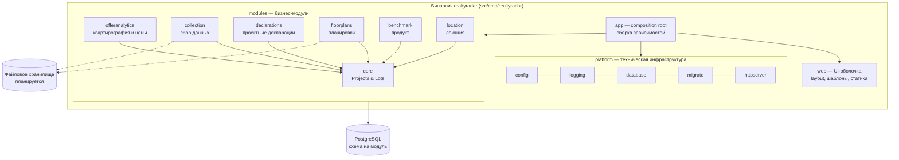
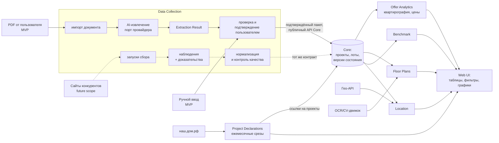

# Архитектура: обзор

> Статус (2026-09-15): технический каркас и **Core MVP** (модель рынка, история лотов, входной
> контракт, минимальный UI — [core-mvp.md](core-mvp.md)). Остальные модули и импорт PDF не
> реализованы. Всё, что помечено как «планируется», ещё не существует в коде.

## 1. Назначение системы

Realty Radar собирает, хранит, анализирует и сравнивает данные по рынку новостроек и
конкурентным жилым проектам: лоты и цены, квартирографию, планировки, продуктовые
характеристики, локацию, данные проектных деклараций. Источник бизнес-требований —
[исходное ТЗ](../requirements/source/tz-text.md). Границы — в [scope.md](../requirements/scope.md).

## 2. Архитектурные принципы

1. **Модульный монолит.** Одно приложение и один деплой, но код разделён на бизнес-модули с
   явными границами ([ADR-0001](../decisions/0001-modular-monolith.md)).
2. **Core в центре.** Модуль Core владеет доменной моделью рынка: девелоперы, проекты,
   очереди, корпуса, секции, лоты, конкуренты, источники, история. Core не зависит от
   бизнес-модулей. Остальные модули по умолчанию зависят только от его публичных контрактов.
   Core хранит только данные своей доменной ответственности
   ([ADR-0004](../decisions/0004-module-boundaries.md)).
3. **Сбор данных отделён от домена.** Коллекторы и парсеры не пишут в таблицы Core. Они
   передают нормализованные данные через публичный API Core. Добавление источника не меняет
   бизнес-логику Core.
4. **Слои внутри модуля.** `domain` (чистые правила) ← `app` (сценарии и порты) ←
   `adapters` (PostgreSQL, HTTP/UI, внешние системы, AI/ML). Зависимости направлены внутрь,
   к домену.
5. **Внешнее — за интерфейсами.** Сайты, наш.дом.рф, картографические API, OCR/CV/ML-движки,
   файловое хранилище — адаптеры за портами модулей. Их можно заменить, не трогая домен.
6. **Данные с историей и доказательствами.** Исходные наблюдения и файлы-доказательства
   (скриншоты, PDF, HTML) сохраняются, производные показатели можно пересчитать
   ([ADR-0003](../decisions/0003-data-storage.md)).
7. **Простая инфраструктура.** Go-бинарник + PostgreSQL. Новые компоненты (очередь,
   объектное хранилище, отдельный ML-сервис) появляются, только когда без них нельзя, и
   фиксируются через ADR ([ADR-0002](../decisions/0002-tech-stack.md)).
8. **Правила проверяются автоматически.** Зависимости между модулями и слоями проверяет
   тест `tests/architecture`.

## 3. Основные компоненты

| Компонент | Путь | Статус | Ответственность |
|---|---|---|---|
| Точка входа | `src/cmd/realtyradar` | есть | Разбор команд `serve`, `migrate`, `demo`, `version`; загрузка `.env` |
| Composition root | `src/app` | есть | Создаёт конфигурацию, логгер, пул БД, HTTP-сервер; подключает модули. Бизнес-логики нет |
| Platform | `src/platform/*` | есть | Конфигурация, логирование, пул PostgreSQL, миграции, HTTP-сервер, middleware, health. Ничего не знает о модулях |
| Web | `src/web` | есть (общий layout `web.Renderer`, стартовая страница) | Общий layout, статика, рендеринг. Бизнес-страницы — в HTTP-адаптерах модулей |
| Модули | `src/modules/*` | Core MVP реализован ([core-mvp.md](core-mvp.md)); остальные — только границы (`doc.go`) | Бизнес-функциональность, см. [modules.md](modules.md) |
| Миграции | `migrations/` | есть (схема `core` и таблицы Core MVP) | SQL-миграции всех модулей (goose), встраиваются в бинарник |
| Архитектурные тесты | `tests/architecture` | есть | Проверка правил зависимостей |
| Интеграционные тесты | `tests/integration` | есть | Миграции, readiness, репозитории и use cases Core, сценарий UI на реальном PostgreSQL |

## 4. Границы модулей

Семь бизнес-модулей: Core, Offer Analytics, Data Collection, Project Declarations,
Floor Plan Analysis, Product Benchmark, Location Analytics. Ответственность, зависимости,
состав и исключения — в [modules.md](modules.md). Отличие от предварительной декомпозиции:
аналитика цен (ТЗ п. 3) включена в модуль аналитики предложения
([ADR-0004](../decisions/0004-module-boundaries.md)).

## 5. Взаимодействие модулей

- **Внутрипроцессные вызовы Go** через публичный API модуля (корневой пакет
  `src/modules/<module>`). Внутренности модуля (`internal/`) недоступны другим модулям —
  это гарантирует компилятор Go.
- **Направление зависимостей** ([ADR-0004](../decisions/0004-module-boundaries.md)): Core
  не зависит от бизнес-модулей. Некорневые модули по умолчанию зависят только от публичных
  контрактов Core. Прямая зависимость между некорневыми модулями допускается только при
  реальной бизнес-необходимости, по отдельному ADR и с разрешением в архитектурном тесте.
  Сейчас таких зависимостей нет.
- **Владение данными:** данные не переносятся в Core ради обмена между модулями. Результаты
  анализа планировок остаются в Floor Plans, характеристики локации — в Location, оценки
  продукта — в Benchmark. Если модулю понадобятся данные нескольких модулей, при появлении
  конкретного сценария выбирается один из вариантов: явная зависимость через публичный
  контракт, read/reporting model или агрегирующий модуль. Заранее эта инфраструктура не
  создаётся.
- **Данные:** модуль пишет только в свою схему PostgreSQL. Другой модуль читает эти данные
  через API модуля-владельца или через явно опубликованные им представления (views)
  ([ADR-0003](../decisions/0003-data-storage.md)).
- **Асинхронность (планируется):** фоновые задачи (сбор, ежемесячная выгрузка, пересчёты)
  выполняются очередью задач на PostgreSQL. Библиотека выбирается при первой фоновой задаче
  (кандидат — River, см. ADR-0002).
- **Связывание модулей** выполняется только в `src/app`.

## 6. Внешние системы

| Система | Модуль | Назначение | Статус |
|---|---|---|---|
| PDF-документы по проектам и лотам (загружает пользователь) | Data Collection — импорт документов | Проекты, корпуса, лоты, цены, статусы; факты планировок | **MVP**, планируется ([pdf-extraction.md](pdf-extraction.md), [ADR-0008](../decisions/0008-mvp-document-import-ai-extraction.md) — Принят) |
| AI / Vision-провайдер для извлечения данных из PDF | Data Collection — порт `DocumentExtractor` | Преобразование PDF в Extraction Result | **MVP**, планируется; провайдер не выбран ([Q-GEN-11, Q-PDF-02](../requirements/open-questions.md)), выбор — отдельный ADR |
| Сайты девелоперов и конкурентов | Data Collection | Лоты, цены, статусы, акции, скриншоты | **future scope** (не входит в MVP), [Q-GEN-07](../requirements/open-questions.md) |
| наш.дом.рф | Project Declarations | Проектные декларации, продажи, остатки | планируется, [Q-DECL-01](../requirements/open-questions.md) |
| Документы проекта (декларация, ДДУ, проектная документация, экспертиза, презентация) | Data Collection → Benchmark / Floor Plans | Характеристики, планировки | планируется |
| Картографические, POI- и маршрутные API | Location Analytics | POI, расстояния, время в пути | планируется, провайдер не выбран ([Q-LOC-01](../requirements/open-questions.md)) |
| OCR / CV / ML-движки | Floor Plan Analysis | Анализ планировок (извлечение фактов из PDF — AI-провайдер Data Collection, ADR-0008) | планируется, подход не выбран ([Q-PLAN-09](../requirements/open-questions.md)) |
| PostgreSQL | все | Основное хранилище | есть |
| Файловое хранилище (локальная ФС → S3-совместимое) | Collection, Floor Plans, Declarations | PDF (первый потребитель — импорт PDF в MVP), ответы AI-провайдера, в будущем скриншоты и исходные ответы сайтов | планируется |
| Yandex DataLens (внешний потребитель) | Offer Analytics, Declarations — через опубликованные представления | Визуализация аналитики вместо или вместе с собственными BI-страницами. Показатели считаются в Realty Radar, DataLens их только отображает; подключение ролью только на чтение | допустимый вариант, не выбран ([ADR-0005](../decisions/0005-ui-approach-and-bi.md), [Q-GEN-10, Q-GEN-12](../requirements/open-questions.md)) |

## 7. Потоки данных (целевые)

1. **Лоты и цены (MVP — из PDF и ручного ввода).** Пользователь загружает PDF, Data Collection
   сохраняет файл и запускает AI-извлечение через порт провайдера. Результат (Extraction Result)
   проходит валидацию. Пользователь проверяет и исправляет данные, сопоставляет объекты с Core
   (кандидаты предлагает Core) и подтверждает импорт. Core получает только подтверждённый пакет
   через API, фиксирует новую версию состояния при изменении и обновляет даты наблюдений
   ([pdf-extraction.md](pdf-extraction.md), [core-domain-model.md](core-domain-model.md); на
   согласовании). **Future scope:** коллектор выполняет запуск сбора с сайта, сохраняет
   наблюдения и доказательства, нормализует данные и передаёт их в Core тем же контрактом.
2. **Аналитика предложения** читает текущее состояние и историю лотов Core и строит срезы и
   показатели. Хранит только производные данные, которые можно пересчитать.
3. **Декларации** загружаются ежемесячно как срезы и привязываются к проектам Core. Из них
   рассчитываются общий, проданный и остаточный объём.
4. **Планировки, продуктовые характеристики, локация** привязываются к сущностям Core
   (лот или планировка, проект, корпус) по идентификаторам и хранятся в схемах своих модулей.

## 8. Технологии

Go 1.27, `net/http` (стандартный роутер), `html/template` (серверный рендеринг), PostgreSQL
17 через pgx v5, миграции goose v3, `log/slog`. Обоснование и альтернативы —
[ADR-0002](../decisions/0002-tech-stack.md).

## 9. Подход к UI и BI

- **Решение для MVP — SSR + htmx** ([ADR-0005](../decisions/0005-ui-approach-and-bi.md)).
  Сервер рендерит страницы, htmx обновляет их частично, графики получают с сервера готовые
  данные, для отдельных сложных виджетов допустимы изолированные JS-«острова». htmx и
  библиотека графиков пока не подключены: они появятся с первыми интерактивными страницами.
- **Контрольная точка — реализация Offer Analytics.** Если сложность интерактивной
  аналитики потребует значительного клиентского состояния, вариант React/TypeScript
  пересматривается отдельным ADR. Признаки и порядок фиксации результата — в ADR-0005.
- **DataLens** — допустимый внешний BI поверх опубликованных представлений; решение об
  использовании не принято.
- Инвариант для всех трёх вариантов: **показатели вычисляются в модулях** (Go или SQL-представления
  модуля), а не в шаблонах, JS или вычисляемых полях BI.
