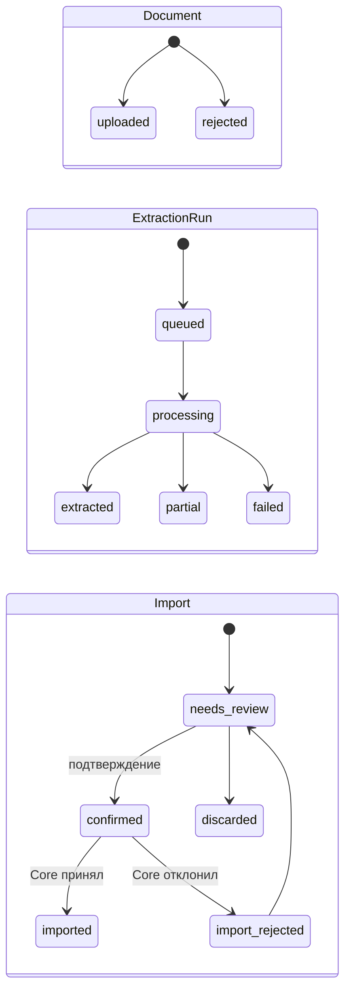
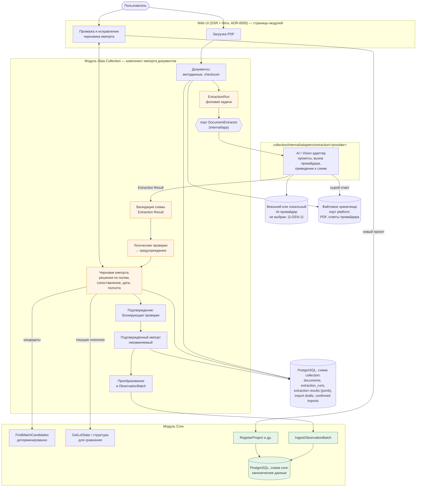

# Импорт PDF с AI-извлечением (MVP) — проект

> **Статус: проект утверждён (2026-09-15). Не реализовано — реализация импорта PDF будет следующим этапом после Core MVP.**
> Нет загрузки PDF, хранилища файлов, AI-адаптера, промптов, UI проверки и таблиц. AI-модель и
> провайдер **не выбраны**. Архитектурное решение —
> [ADR-0008](../decisions/0008-mvp-document-import-ai-extraction.md) (Принят). Модель Core, в
> которую попадают подтверждённые данные, — [core-domain-model.md](core-domain-model.md). Вопросы —
> [open-questions.md](../requirements/open-questions.md) (раздел PDF).

## Содержание

1. [Назначение и гипотеза MVP](#1-назначение-и-гипотеза-mvp)
2. [Scope MVP](#2-scope-mvp)
3. [Место в архитектуре](#3-место-в-архитектуре)
4. [Сценарий и состояния](#4-сценарий-и-состояния)
5. [Схема потока](#5-схема-потока)
6. [Принципы извлечения](#6-принципы-извлечения)
7. [Standardized JSON: Extraction Result](#7-standardized-json-extraction-result)
8. [Валидация](#8-валидация)
9. [Проверка, исправление, подтверждение](#9-проверка-исправление-подтверждение)
10. [Преобразование в Core](#10-преобразование-в-core)
11. [Provenance](#11-provenance)
12. [Extraction и Floor Plan Analysis](#12-extraction-и-floor-plan-analysis)
13. [Порт AI-провайдера](#13-порт-ai-провайдера)
14. [Хранение: временные и канонические данные](#14-хранение-временные-и-канонические-данные)
15. [Ручной ввод](#15-ручной-ввод)
16. [Совместимость с будущим сбором с сайтов](#16-совместимость-с-будущим-сбором-с-сайтов)
17. [Вопросы](#17-вопросы)
18. [Решения, требующие подтверждения](#18-решения-требующие-подтверждения)

---

## 1. Назначение и гипотеза MVP

**[уточнение 2026-09-15]** Автоматизированный сбор с сайтов конкурентов не входит в MVP. Основной
автоматизированный способ получения данных из неструктурированного источника — **PDF**. Ручной
ввод остаётся.

Основание в ТЗ: п. 1 — «извлечение данных из PDF», «распознавание площадей и подписей помещений
с изображения»; п. 4 — документы проекта как источники сведений; п. 3 — перечень данных лота.

Гипотеза MVP:

> Можно ли с помощью multimodal AI / Vision преобразовывать разнородные PDF по недвижимости в
> стандартизированное структурированное представление Realty Radar?

Следствия для проектирования:

- формат PDF заранее **не фиксируется**, собственный CV/OCR-алгоритм не создаётся;
- AI-провайдер — сменный адаптер за портом; замена провайдера не меняет формат результата,
  проверку и Core;
- результат AI — **предварительный**. В Core попадает только то, что подтвердил пользователь;
- проверка гипотезы требует критерия успеха и реальных PDF (Q-PDF-10, Q-PDF-01). Для
  проектирования они не нужны, для реализации и оценки — обязательны.

## 2. Scope MVP

| Входит | Не входит |
|---|---|
| Загрузка PDF пользователем, хранение файла и метаданных | Автоматический сбор с сайтов, парсеры сайтов, browser automation, обход anti-bot (future scope) |
| AI-извлечение в стандартный JSON (Extraction Result) через порт | Выбор AI-модели и провайдера (отдельное решение, ADR) |
| Валидация схемы и логические проверки | Собственный OCR/CV |
| Проверка, исправление, дополнение результата пользователем | Автоматический импорт без проверки |
| Сопоставление с объектами Core (кандидаты от Core, решение пользователя) | Fuzzy matching как утверждённое правило |
| Подтверждение и приём в Core через `IngestObservationBatch` | Анализ планировок (коэффициенты, классификация, похожие) — Floor Plans |
| Ручной ввод данных лотов тем же сценарием проверки | Извлечение продуктовых характеристик для Benchmark (п. 4), декларации наш.дом.рф |
| | Промпты для production-извлечения (появятся при реализации адаптера) |

Поддержка всех видов содержимого PDF в MVP **не требуется**. Формат JSON не должен делать
невозможными: несколько лотов в документе, несколько планировок, документ только о проекте,
смешанное содержимое.

## 3. Место в архитектуре

### 3.1. Варианты

| Вариант | Плюсы | Минусы | Итог |
|---|---|---|---|
| **Data Collection** (компонент «импорт документов») | Collection уже отвечает за «импорт файлов и ручные загрузки», «получение документов проекта как файлов», нормализацию и контроль качества, передачу в Core через ingestion API ([modules.md](modules.md) п. 3.3). PDF — ещё один внешний источник наравне с будущими сайтами. Один владелец входного контура в Core | Модуль объединяет два разных способа получения (документы и будущий сбор) | **выбрано** |
| Floor Plan Analysis | Модуль уже предполагал приём PDF и OCR/CV | PDF в MVP — универсальный источник (проект, корпуса, лоты, цены), а не только планировки. Floor Plans стал бы источником данных лотов для Core и смешал бы анализ с получением данных | отклонено |
| Новый бизнес-модуль «Documents / Import» | Явная граница для AI-сценария | Восьмой модуль с той же ответственностью, что у Collection, и той же зависимостью от Core; дублирование входного контура. Нет доменной причины | отклонено; возможно позже отдельным ADR, если импорт документов разрастётся |
| Core | — | Прямо запрещено: Core не читает PDF и не вызывает AI | отклонено |

### 3.2. Решение (предложение, ADR-0008)

- PDF Import / AI Extraction — **часть модуля Data Collection** (`src/modules/collection`).
  Отдельный бизнес-модуль не создаётся.
- AI-провайдер — порт в `collection/internal/app`, адаптеры в
  `collection/internal/adapters/extraction/<provider>/`.
- Файлы — порт файлового хранилища в `platform` (направление ADR-0002/ADR-0003: локальная ФС →
  S3-совместимое). PDF-импорт — первый потребитель.
- Extraction Result, черновики проверки и подтверждённые импорты — схема `collection`.
- Core получает только подтверждённые нормализованные данные через `IngestObservationBatch` и
  команды Core.
- Факты о планировках и помещениях, извлечённые из PDF, **не передаются в Core**. До реализации
  Floor Plans они хранятся в Extraction Result. Способ передачи в Floor Plans (зависимость
  `floorplans → collection` или публикация фактов Collection) выбирается отдельным ADR по ADR-0004
  при реализации Floor Plans.
- Анализ планировок остаётся в Floor Plans, как и ранее.

Изменение границ: ADR-0002 и A-17 относили OCR/CV/ML-распознавание к Floor Plans, `modules.md`
п. 3.5 — «приём изображений и PDF» и «помещения и их площади и подписи». Предлагается
разделение: **извлечение фактов из документов** — Collection, **анализ планировок** — Floor Plans.

## 4. Сценарий и состояния

### 4.1. Сценарий пользователя

1. Пользователь загружает PDF.
2. Система сохраняет файл и метаданные (контрольная сумма; предупреждение о повторной загрузке).
3. Запускается AI-извлечение (фоновая задача). Результат — Extraction Result.
4. Результат проходит валидацию схемы. Невалидный результат не показывается как данные.
5. Логические проверки формируют предупреждения.
6. Создаётся черновик импорта. Пользователь проверяет:
   - какой это документ, на какую дату данные, из какого источника (канала);
   - проект (выбор существующего или создание), корпуса и секции;
   - лоты: значения и доказательства (страница, текст), сопоставление с Core, сравнение с
     текущим состоянием в Core;
   - исправляет, дополняет, исключает элементы, указывает полноту документа.
7. Пользователь подтверждает импорт. Выполняются блокирующие проверки.
8. Collection сохраняет неизменяемый подтверждённый импорт и отправляет пакет в Core.
9. Core принимает пакет целиком или отклоняет с причинами. При отклонении импорт возвращается на
   проверку.

### 4.2. Состояния

Кандидаты из постановки (`uploaded`, `processing`, `extracted`, `partial`, `failed`,
`needs_review`, `confirmed`, `imported`) описывают **три разных объекта**. Один общий enum
смешал бы жизненный цикл файла, попытки извлечения и импорта. Предлагаются три независимых
жизненных цикла. Названия предварительные, окончательный набор — при реализации.

**Document** (загруженный файл):

| Состояние | Смысл |
|---|---|
| `uploaded` | файл сохранён, метаданные записаны |
| `rejected` | файл не принят: не PDF, повреждён, превышены ограничения (Q-PDF-12) |

**ExtractionRun** (попытка извлечения; у документа их может быть несколько: повтор, другой
провайдер или версия адаптера):

| Состояние | Смысл |
|---|---|
| `queued` | ожидает выполнения |
| `processing` | выполняется |
| `extracted` | результат получен и прошёл валидацию схемы |
| `partial` | результат валиден, но извлечение неполное: часть страниц не обработана, провайдер сообщил об ошибках части документа. Проверка возможна |
| `failed` | ошибка провайдера, таймаут, результат не прошёл валидацию схемы (причина фиксируется: `provider_error`, `timeout`, `invalid_output`) |

**Import** (черновик → подтверждённый импорт; создаётся из `extracted`/`partial` или без документа
при ручном вводе):

| Состояние | Смысл |
|---|---|
| `needs_review` | черновик создан, требует проверки |
| `confirmed` | пользователь подтвердил; подтверждённое содержимое неизменяемо |
| `imported` | Core принял пакет |
| `import_rejected` | Core отклонил пакет (конфликт сопоставления или истории, нарушение инварианта); возвращается в `needs_review` с причинами |
| `discarded` | пользователь отказался от импорта (документ не подходит, извлечение неудачно) |



---

## 5. Схема потока



| Что | Где | Характер данных |
|---|---|---|
| PDF-файл | файловое хранилище (порт `platform`); метаданные — схема `collection` | исходный документ, доказательство; срок хранения — Q-PDF-09 |
| Сырой ответ провайдера | файловое хранилище | технический, для разбора ошибок; временный |
| Extraction Result (JSON) | схема `collection`, `jsonb` (переменная структура — допустимое применение jsonb по ADR-0003) | **предварительный**, неизменяемый результат попытки |
| Черновик импорта (решения пользователя) | схема `collection` | **временный**, рабочий |
| Подтверждённый импорт | схема `collection` | неизменяемая запись подтверждения, провенанс; не канонические данные |
| Изображения страниц для проверки | кэш файлового хранилища | временный, производный |
| `IngestionBatch`, лоты, размещения, версии, структура | схема `core` | **канонические** |

AI-адаптер находится **только** в Collection. Core не видит ни провайдера, ни JSON извлечения.

---

## 6. Принципы извлечения

1. **Неизвестное значение ≠ предполагаемое значение.** Если значение нельзя достоверно определить
   из документа, результат содержит `status: "not_found"` (или `unreadable`, `ambiguous`) и
   `value: null`. Придуманное, «типичное» или взятое из общих знаний модели значение недопустимо.
2. **Только явные факты документа.** Извлекается то, что написано или однозначно обозначено
   (текст, таблица, подпись на плане). Не извлекается то, что требует интерпретации изображения
   или расчёта: количество окон, тип помещения по форме, площадь по масштабу чертежа.
3. **Никаких расчётов в извлечении.** Цена за м² не вычисляется из цены и площади; скидка не
   вычисляется из двух цен; комнатность не выводится из числа спален. Если величина **указана** в
   документе, она извлекается как указанная (`price_per_sqm_stated`) — для проверки, а не для Core.
4. **Нормализация представления допустима, изменение смысла — нет.** «12,5 млн ₽» → `12500000`
   (RUB), «72,4 кв.м» → `72.4`. Исходный текст сохраняется в `raw`.
5. **Классификации — текстом документа.** Отделка, статус, тип лота возвращаются как в документе
   («чистовая», «бронь»). Сопоставление с кодами справочников Core выполняет Collection
   (таблица соответствий + пользователь), а не провайдер. Поэтому формат не зависит от справочников
   Core, а провайдер не угадывает коды.
6. **Доказательство для каждого значения.** Значение со статусом `extracted` должно иметь evidence
   (страница и фрагмент текста). Значение без evidence помечается проблемой `missing_evidence` и не
   может быть принято массово.
7. **Confidence — подсказка, не критерий.** Confidence необязателен, зависит от провайдера и не
   сравним между провайдерами. В MVP он **не используется** для автоматического принятия.
8. **Результат не знает Core.** В Extraction Result нет канонических ID. Связи между извлечёнными
   объектами — локальные ссылки (`ref`).

---

## 7. Standardized JSON: Extraction Result

### 7.1. Почему не `document / extracted_data / extraction`

Структура из постановки — хорошая основа, но предлагаются уточнения:

| Уточнение | Причина |
|---|---|
| `document` содержит только то, что **система знает** о файле (checksum, страницы, имя). Сведения **из** документа (вид, дата, издатель) — `document_facts` с evidence | метаданные файла достоверны, извлечённые — нет; их нельзя смешивать |
| `extracted_data` → `entities` с **типизированными массивами** (`projects`, `buildings`, `lots`, `floor_plans`) и локальными `ref` | несколько объектов, документ только о проекте, смешанное содержимое; явные связи вместо вложенности, которая не выражает «лот без корпуса» или «планировка на несколько лотов» |
| Каждое значение — **обёртка `ExtractedValue`** со статусом, raw, evidence, confidence | частичные данные, null, провенанс и проблемы — на уровне значения |
| `issues` — единый список проблем (уровень документа, объекта или поля) | предупреждения и ошибки распознавания в одном месте, со ссылками на объекты |
| `unmapped_facts` — сведения, для которых нет поля | «другие сведения» не теряются и не втискиваются в чужие поля |
| `schema_version` | эволюция формата без привязки к провайдеру |

### 7.2. Верхний уровень

```json
{
  "schema": "realtyradar/document-extraction",
  "schema_version": "0.1",
  "document": { },
  "extraction": { },
  "document_facts": { },
  "entities": {
    "projects": [ ],
    "buildings": [ ],
    "lots": [ ],
    "floor_plans": [ ]
  },
  "unmapped_facts": [ ],
  "issues": [ ]
}
```

| Раздел | Кто заполняет | Содержание |
|---|---|---|
| `document` | Collection (не AI) | `document_id`, `file_name`, `sha256`, `page_count`, `mime_type`, `uploaded_at` |
| `extraction` | Collection + адаптер | `run_id`, `adapter` (идентификатор и версия адаптера), `provider_model` (как сообщил провайдер, информационно), `started_at`, `finished_at`, `status` (`completed` / `partial`), `pages_processed[]`, `pages_failed[]` |
| `document_facts` | AI | `document_kind` (текстом: «прайс-лист», «планировка», «презентация»), `document_date` (дата актуальности, если указана), `publisher` (кем выпущен, если указано), `title` |
| `entities` | AI | объекты, п. 7.4 |
| `unmapped_facts` | AI | `{ "label", "value": ExtractedValue, "entity_ref"? }` |
| `issues` | AI + валидация | п. 7.5 |

### 7.3. ExtractedValue

```json
{
  "status": "extracted",
  "value": 12500000,
  "raw": "12 500 000 ₽",
  "unit": "RUB",
  "evidence": [
    { "page": 2, "text": "Кв. 145 … 12 500 000 ₽", "bbox": [0.12, 0.40, 0.88, 0.43] }
  ],
  "confidence": 0.91,
  "candidates": null
}
```

| Поле | Обязательно | Правило |
|---|---|---|
| `status` | да | `extracted` — значение явно есть в документе; `not_found` — в документе нет; `unreadable` — место найдено, прочитать нельзя; `ambiguous` — в документе несколько противоречащих значений (перечислены в `candidates`) |
| `value` | да | не `null` **только** при `extracted`. Тип — по полю (число, строка, дата ISO 8601, список строк) |
| `raw` | при `extracted` | исходный фрагмент как в документе |
| `unit` | для величин | `RUB`, `m2`; иные единицы в `value` не допускаются |
| `evidence[]` | при `extracted`, `ambiguous`, `unreadable` | `page` (с 1), `text` (дословно), `bbox` необязательно (доли страницы 0..1: x0, y0, x1, y1) |
| `confidence` | нет | 0..1 или `null`; только для подсветки при проверке |
| `candidates` | при `ambiguous` | массив `{value, raw, evidence}` |

Отсутствующее поле объекта равнозначно `not_found`. Статуса «выведено» / «предположено» **нет**
намеренно.

### 7.4. Объекты

Все поля — `ExtractedValue`, кроме `ref` и ссылок. Любое поле может быть `not_found`.

**projects[]**

| Поле | Смысл |
|---|---|
| `ref` | локальный ID (`"p1"`) |
| `name` | название ЖК |
| `developer_name` | девелопер, как указан |
| `city`, `address` | как указаны |
| `class_stated` | класс, если указан в документе (не назначенный класс Core) |

**buildings[]**

| Поле | Смысл |
|---|---|
| `ref`, `project_ref` | ссылки |
| `name` | корпус как указан («Корпус 2», «к. 1.2») |
| `phase_name` | очередь, если указана |
| `section_names` | секции, если перечислены |
| `floors_count` | этажность, если указана |
| `completion_stated` | срок сдачи текстом, если указан (в Core — после Q-CORE-12) |

**lots[]**

| Поле | Смысл | В Core |
|---|---|---|
| `ref`, `project_ref`, `building_ref`, `floor_plan_ref` | ссылки | — |
| `source_lot_id` | ID лота, если указан в документе | K1 |
| `lot_type_stated` | «квартира», «кладовая», … | `lot_type` после сопоставления |
| `section_name` | секция | структура |
| `number` | номер квартиры / лота | K2 |
| `floor` | этаж | `Lot.floor` |
| `rooms_stated` | «3», «студия», «евро-2» — как указано | `rooms`, `layout_format` после Q-CORE-24 |
| `area_total` | общая площадь, м² | `area_total` |
| `price` | актуальная цена предложения, как указана | `price` |
| `price_before_discount` | старая цена, если указана | `price_before_discount` |
| `price_per_sqm_stated` | указанная цена за м² | **нет**, только проверка |
| `discount_stated` | указанная скидка (сумма или %) | **нет**, только проверка. `price_before_discount` из неё не вычисляется |
| `finish_stated` | отделка текстом | `finish_code` после сопоставления |
| `status_stated` | статус текстом | `status` после сопоставления |
| `views_stated` | виды текстом (список) | `view_codes` |
| `features_stated` | особенности текстом (терраса, …) | `feature_codes` |
| `promotion_stated` | упоминание акции | `has_promotion` |
| `sales_terms_stated` | рассрочка, ипотека, бронирование — текстом | **нет**; остаётся в Extraction Result до утверждённой модели условий (Q-CORE-10, LATER) |
| `living_area_stated`, `kitchen_area_stated` | если указаны | **нет** (Q-CORE-29) |

**floor_plans[]** — факты с изображения или страницы планировки, без анализа:

| Поле | Смысл |
|---|---|
| `ref`, `lot_refs[]` | планировка может относиться к нескольким лотам или ни к одному (каталог типовых планировок) |
| `page`, `region_bbox` | где на странице изображение плана |
| `layout_label` | подпись типа («Тип 2А»), если есть |
| `total_area_stated`, `living_area_stated` | площади, указанные на плане |
| `rooms[]` | `{ "label": ExtractedValue, "area": ExtractedValue }` — **подписи и площади как напечатаны** |

### 7.5. Issues

```json
{
  "severity": "warning",
  "code": "value_conflict",
  "message": "На странице 2 площадь 72,4 м², на странице 5 — 72,6 м²",
  "entity_ref": "l3",
  "field": "area_total",
  "pages": [2, 5],
  "origin": "extractor"
}
```

`severity`: `error` (объект или часть документа не извлечены), `warning` (требует внимания),
`info`. `origin`: `extractor` (сообщил провайдер/адаптер) или `validation` (обнаружила система,
п. 8). Словарь кодов (`missing_evidence`, `value_conflict`, `page_unreadable`, `duplicate_lot`,
`stated_price_per_sqm_mismatch`, …) расширяется при реализации.

### 7.6. Пример (сокращённый)

```json
{
  "schema": "realtyradar/document-extraction",
  "schema_version": "0.1",
  "document": { "document_id": "0192…", "file_name": "price_k2.pdf", "sha256": "…", "page_count": 3 },
  "extraction": { "run_id": "0192…", "adapter": "example-adapter/0.1", "status": "completed",
                  "pages_processed": [1, 2, 3], "pages_failed": [] },
  "document_facts": {
    "document_kind": { "status": "extracted", "value": "прайс-лист", "raw": "Прайс-лист",
                       "evidence": [{ "page": 1, "text": "Прайс-лист" }] },
    "document_date": { "status": "extracted", "value": "2026-09-01", "raw": "на 01.09.2026",
                       "evidence": [{ "page": 1, "text": "Цены действительны на 01.09.2026" }] }
  },
  "entities": {
    "projects": [{ "ref": "p1",
      "name": { "status": "extracted", "value": "ЖК Пример", "raw": "ЖК «Пример»",
                "evidence": [{ "page": 1, "text": "ЖК «Пример»" }] },
      "developer_name": { "status": "not_found", "value": null } }],
    "buildings": [{ "ref": "b1", "project_ref": "p1",
      "name": { "status": "extracted", "value": "Корпус 2", "raw": "Корпус 2",
                "evidence": [{ "page": 1, "text": "Корпус 2" }] } }],
    "lots": [{ "ref": "l1", "project_ref": "p1", "building_ref": "b1",
      "number": { "status": "extracted", "value": "145", "raw": "145",
                  "evidence": [{ "page": 2, "text": "145 | 7 | 2 | 64,3 | 15 900 000" }] },
      "floor": { "status": "extracted", "value": 7, "raw": "7", "evidence": [{ "page": 2, "text": "145 | 7 | 2 | 64,3 | 15 900 000" }] },
      "area_total": { "status": "extracted", "value": 64.3, "raw": "64,3", "unit": "m2",
                      "evidence": [{ "page": 2, "text": "145 | 7 | 2 | 64,3 | 15 900 000" }] },
      "price": { "status": "extracted", "value": 15900000, "raw": "15 900 000", "unit": "RUB",
                 "evidence": [{ "page": 2, "text": "145 | 7 | 2 | 64,3 | 15 900 000" }] },
      "price_before_discount": { "status": "not_found", "value": null },
      "finish_stated": { "status": "not_found", "value": null } }],
    "floor_plans": []
  },
  "unmapped_facts": [],
  "issues": []
}
```

Значения примера условные и служат только иллюстрацией формата.

### 7.7. JSON Schema и версионирование

- Формат фиксируется JSON Schema (draft 2020-12) в модуле Collection при реализации, с общим
  определением `ExtractedValue` и условиями: `value = null`, если `status ≠ extracted`;
  `evidence` обязательно при `extracted`.
- `schema_version` — семантическая версия формата. Адаптер обязан вернуть результат указанной
  версии; валидатор Collection отклоняет несоответствие (`invalid_output`).
- Добавление необязательных полей — минорная версия; изменение смысла или удаление — мажорная,
  с преобразованием хранимых результатов или поддержкой обеих версий при проверке.
- Формат **не является контрактом Core**. Core зависит только от `IngestObservationBatch`.

---

## 8. Валидация

| Уровень | Когда | Что проверяет | Итог |
|---|---|---|---|
| 1. Схема | сразу после ответа адаптера | соответствие JSON Schema; правила `status`/`value`/`evidence`; разрешимость `ref` | несоответствие → `ExtractionRun.failed (invalid_output)`; данные не показываются |
| 2. Логические проверки | при создании черновика и после каждого исправления | только **логические** проверки без бизнес-порогов: площадь и цена > 0; `price_before_discount ≥ price`; этаж ≤ этажности, если обе известны; указанная цена за м² ≠ цена / площадь (с учётом округления до рубля); один номер лота дважды в корпусе; лоты без проекта; неизвестные значения справочников; значения без evidence | предупреждения в `issues` (`origin: validation`); не блокируют сами по себе |
| 3. Подтверждение | при нажатии «Подтвердить» | выбран проект; выбран источник; задан момент данных и его основание; у каждого включённого лота решено сопоставление (`matched`/выбран кандидат/«новый»); нет `insufficient_identity` среди включённых; классификации сопоставлены с кодами или явно `unknown`; предупреждения уровня `error` разрешены | блокирует подтверждение |
| 4. Приём Core | `IngestObservationBatch` | инварианты Core, повторная проверка сопоставления, конфликты истории | пакет принят целиком или отклонён с причинами |

Правдоподобие («цена слишком низкая для класса») **не проверяется**: это бизнес-порог, которого нет
в требованиях.

---

## 9. Проверка, исправление, подтверждение

### 9.1. Черновик импорта

Extraction Result **не редактируется**. Решения пользователя хранятся отдельно — в черновике
импорта, который ссылается на результат. Так всегда видно, что предложил AI и что решил человек.

| Уровень | Решения пользователя |
|---|---|
| Документ | источник (канал, Q-PDF-07); момент данных и основание (`document_date` / `received_date` / `upload_time`, Q-PDF-03); полнота (`partial` по умолчанию; `complete` — только явным утверждением с указанием области, Q-PDF-06) |
| Проект | выбрать существующий проект Core (с подсказкой `FindMatchCandidates`) или создать новый (`RegisterProject`) |
| Корпус, секция | использовать существующий / создать новый / «не указан» |
| Лот | включить или исключить; решение сопоставления (п. 9.2); решения по полям (п. 9.3); подтвердить исправление размещения, если отличается от Core |
| Поле | принять / исправить / ввести / очистить; для пустых — `unknown` или `absent` |
| Классификация | сопоставить текст с кодом справочника Core или оставить `unknown` |

### 9.2. Сопоставление при проверке

Для каждого объекта Collection вызывает `FindMatchCandidates` Core и показывает состояние
([core-domain-model.md](core-domain-model.md) п. 7.4):

| Состояние | Что видит пользователь | Возможные решения |
|---|---|---|
| `matched` | предвыбранный объект Core, сработавшее правило, сравнение «в Core сейчас / в документе» | принять; выбрать другой; «новый»; исключить |
| `possible_match` | список кандидатов с различиями | выбрать кандидата; «новый»; исключить |
| `new` | «объект будет создан» | принять; вручную указать существующий; исключить |
| `insufficient_identity` | чего не хватает (номер, корпус) | дополнить идентичность (ввести номер); вручную указать существующий; исключить |

Сравнение с Core полезно и без изменения идентичности: пользователь видит, что именно
изменится («цена 15 400 000 → 15 900 000»). Так ошибки распознавания видны до записи в историю.

### 9.3. Решения по полям

| Решение | Смысл | Значение в пакете Core |
|---|---|---|
| `accepted` | значение AI подтверждено | `value` |
| `corrected` | пользователь заменил значение AI | `value` (исправленное) |
| `entered` | AI не нашёл, пользователь ввёл | `value` |
| `unknown` | значение не известно (по умолчанию для `not_found`, `unreadable`, неразрешённого `ambiguous`) | `unknown` |
| `absent` | документ явно показывает отсутствие (например, прайс-лист со столбцом скидок, где у лота скидки нет) | `absent` |

Массовое принятие допустимо для значений со статусом `extracted` и evidence, без предупреждений.
Нужна ли пользователю проверка каждого поля — Q-PDF-04. Предложение для MVP: весь импорт
просматривается и подтверждается целиком; поля с предупреждениями, без evidence или `ambiguous`
требуют явного решения.

### 9.4. Подтверждение

- Выполняются блокирующие проверки (п. 8, уровень 3).
- Создаётся **неизменяемый подтверждённый импорт**: итоговые значения, решения по полям, ссылки на
  Extraction Result и документ, момент подтверждения, подтвердивший пользователь (когда появятся
  пользователи — Q-GEN-01, Q-PDF-05).
- Подтверждённый импорт преобразуется в пакет и отправляется в Core. Повторная отправка
  идемпотентна (`origin_ref` = ID импорта).

### 9.5. Ошибочно подтверждённый импорт

Предложение (Q-PDF-11): пользователь открывает импорт, исправляет значения. Создаётся
корректирующий импорт, который вызывает `CorrectBatchData` в Core. Значения версий меняются без
события в истории ([core-domain-model.md](core-domain-model.md) п. 8.9). Полный отзыв импорта с
переигрыванием истории — LATER.

---

## 10. Преобразование в Core

| Extraction Result / черновик | `ObservationBatch` (Core) |
|---|---|
| ID подтверждённого импорта | `origin_kind = document_import`, `origin_ref` |
| источник, выбранный пользователем | `data_source_id` |
| `document_facts.document_date` (подтверждённая) или иная дата | `observed_at`, `observed_at_basis` |
| полнота и область, указанные пользователем | `completeness`, `scope` |
| момент подтверждения | `confirmed_at` |
| проект, выбранный или созданный при проверке | `scope.project_id` |
| `buildings[]` + решения | `structure[]`: `use_existing(id)` / `create(name, …)` |
| `lots[]` включённые | `items[]` |
| решение сопоставления | `target`: `existing(lot_id)` / `create_new` |
| `source_lot_id` | `source_key`, `key_kind = native` |
| `lot_type_stated` → код | `placement.lot_type` |
| `building_ref`, `section_name`, `floor`, `number` | `placement` (+ `placement_update = apply`, если пользователь подтвердил исправление) |
| `area_total`, `price`, `price_before_discount` | `state.*` с `value` / `unknown` / `absent` |
| `rooms_stated` → число и формат | `state.rooms`, `state.layout_format` (после Q-CORE-24) |
| `finish_stated`, `status_stated`, `views_stated`, `features_stated` → коды | `state.finish_code`, `status`, `view_codes`, `feature_codes` |
| `promotion_stated` | `state.has_promotion` |
| `presence` | `listed` (лот есть в документе) |
| `price_per_sqm_stated`, `discount_stated`, `sales_terms_stated`, `living_area_stated`, `kitchen_area_stated`, `floor_plans[]`, `unmapped_facts`, evidence, confidence, issues | **не передаются в Core**; остаются в Collection |

Если статус лота в документе не указан, поле статуса передаётся как `Unknown`: у нового лота
статус станет `unknown`, у существующего сохранится прежний. Присутствие в документе не означает
«свободен».

### 10.1. Что уже есть в Core MVP (уточнение после реализации Core)

Реализованный контракт — [core-mvp.md](core-mvp.md), п. 5. Импорт PDF может использовать его
как есть: `OriginKind = document_import`, `OriginRef` = ID подтверждённого импорта, решения по
корпусам и секциям, цель лота (существующий / новый), поля `Value` / `Unknown` / `Absent`.
Со стороны Core для импорта PDF **ещё понадобятся** (следующий этап):

- `FindMatchCandidates` — кандидаты сопоставления для экрана проверки (сейчас Core лишь отклоняет
  точный дубликат размещения);
- основание момента данных (`observed_at_basis`), а при полных документах — область и полнота
  пакета (Q-PDF-03, Q-PDF-06);
- приём документов, выпущенных раньше уже загруженных (сейчас такое наблюдение отклоняется,
  Q-CORE-27);
- исправление ошибочно подтверждённого импорта (`CorrectBatchData`, Q-PDF-11).

---

## 11. Provenance

Три уровня, без отдельной audit-системы:

| Уровень | Где | Что отвечает |
|---|---|---|
| Значение в документе | Extraction Result: `evidence` (страница, текст, bbox), `raw`, `confidence`, `issues` | «откуда AI взял значение» |
| Решение человека | черновик и подтверждённый импорт: решение по полю (`accepted` / `corrected` / `entered` / `unknown` / `absent`), значение AI и итоговое значение, момент подтверждения | «AI извлёк» ≠ «пользователь подтвердил / исправил» |
| Каноническое значение | Core: версия → `IngestionBatch` (`origin_kind`, `origin_ref`, `observed_at`, `confirmed_at`) | «какой импорт установил значение в Core» |

Цепочка «значение в Core → пакет → подтверждённый импорт → решение по полю → evidence → PDF»
восстанавливается по ссылкам. Core не хранит полевой провенанс.

---

## 12. Extraction и Floor Plan Analysis

| A. Extraction (Collection, MVP, AI допустим) | B. Analysis (Floor Plans, не MVP) |
|---|---|
| факты, явно присутствующие в документе | характеристики, получаемые обработкой и правилами |
| `total_area = 72.4`, подпись «Кухня-гостиная», `bedroom_area = 14.8` как напечатано, номер квартиры, указанная комнатность | коэффициент полезности, доля кухни-гостиной, плотность помещений, мастер-спальня, проходные помещения, мокрые зоны, окна в санузлах, классификация по шаблонам, похожие планировки |

**Пограничные случаи:**

| Случай | Extraction | Analysis | Предложение |
|---|---|---|---|
| Тип помещения | подпись «Кухня-гостиная» | отнесение к типу `kitchen_living` для расчётов | извлекается подпись; типизация — Floor Plans (Q-PLAN-03) |
| Жилая площадь | «Жилая площадь 42,1 м²» напечатана | сумма площадей жилых комнат | напечатанная — факт; сумма — анализ |
| Количество комнат | «3-комнатная», «евро-2» | подсчёт комнат по чертежу (п. 1) | указанное — факт; подсчёт — анализ |
| Евроформат | «Евро-3» в документе | кухня-гостиная + 2 спальни по планировке | Q-OFFER-03 |
| Площадь помещения | число, напечатанное на плане | площадь, измеренная по масштабу | напечатанное — факт; измерение — анализ, не извлекается |
| Мастер-спальня | подпись «Мастер-спальня» | определение по признакам (санузел, гардероб) | подпись — факт; определение — анализ |
| Терраса, балкон | подпись или отметка в характеристиках | распознавание по форме на чертеже | подпись — факт |
| Окна | — | подсчёт окон (п. 1, «если удастся») | только анализ |
| Vision-модель «читает» чертёж | модель может незаметно для пользователя интерпретировать изображение | — | значение без текстового evidence помечается `missing_evidence` и не принимается массово; интерпретации изображения в извлечении запрещены (п. 6) |
| Одна планировка на много лотов | `floor_plans[].lot_refs[]` | сопоставление типовых планировок | связь из документа — факт; поиск похожих — анализ |

Факты о помещениях в MVP остаются в Extraction Result и подтверждённом импорте. Core их не
получает. Нужно ли их проверять пользователю в MVP — Q-PDF-08.

---

## 13. Порт AI-провайдера

Концептуально (не реализуется):

```
DocumentExtractor (порт, collection/internal/app)
  Extract(ctx, ExtractionRequest) → ExtractionOutput
    ExtractionRequest:  document reference (доступ к файлу через порт хранилища),
                        schema_version, ограничения (страницы, размер)
    ExtractionOutput:   Extraction Result (JSON указанной версии) | ошибка
                        (provider_error, timeout, unsupported_document),
                        технические метаданные (длительность, объём)
```

- Адаптер отвечает за промпты, растеризацию страниц (если провайдеру нужны изображения), вызов
  провайдера, приведение ответа к схеме. Промпты и особенности провайдера за адаптер не выходят.
- Замена провайдера = новый адаптер. Формат результата, проверка, Core не меняются.
- Выбор провайдера — отдельное решение с ADR (новый класс внешней инфраструктуры, CLAUDE.md) после
  ответов Q-GEN-11 (допустимость передачи документов внешнему сервису) и Q-PDF-02.
- Ключи и URL провайдера — конфигурация `RR_*` при реализации адаптера. Таймауты обязательны.
- Тесты адаптера — на сохранённых ответах провайдера (фикстуры), без сети. Для проверки гипотезы
  нужен отдельный набор реальных PDF с эталонной разметкой (Q-PDF-10).

---

## 14. Хранение: временные и канонические данные

| Данные | Характер | Хранение | Удаление |
|---|---|---|---|
| PDF | исходный документ, доказательство | файловое хранилище + метаданные `collection` | Q-PDF-09 |
| Сырой ответ провайдера | технический | файловое хранилище | короткий срок (Q-PDF-09) |
| Extraction Result | предварительный | `collection` (jsonb) | для `discarded` — по сроку; для подтверждённых — пока нужен провенанс |
| Черновик импорта | временный | `collection` | после подтверждения остаётся как часть подтверждённого импорта |
| Подтверждённый импорт | неизменяемая запись подтверждения | `collection` | Q-PDF-09 |
| Изображения страниц | временный кэш | файловое хранилище | в любой момент |
| Данные Core | канонические | `core` | правила Core, не зависят от удаления документов |

---

## 15. Ручной ввод

- Структура, проекты, отношения, портфель — команды и страницы Core.
- Данные лотов — тот же черновик импорта **без документа и без Extraction Result**:
  `origin_kind = manual_entry`, источник `manual` (или канал, если пользователь переносит данные
  из известного источника), решения по полям — `entered`.
- Проверки уровней 2–4 и сопоставление — те же. Отдельной «редактирующей» формы, которая пишет
  в версии Core в обход пакета, нет: иначе ручная правка перестала бы быть наблюдением с
  происхождением и моментом.

---

## 16. Совместимость с будущим сбором с сайтов

| Этап | PDF (MVP) | Сайты (future) | Общее |
|---|---|---|---|
| Получение | загрузка пользователем | коллектор по расписанию | Collection |
| Сырое представление | Extraction Result | наблюдения сбора (формат — при проектировании сбора) | **разное**, намеренно |
| Нормализация | проверка пользователем, сопоставление справочников | адаптер источника, таблицы соответствий | сопоставление с кодами справочников Core |
| Сопоставление | кандидаты Core + решение пользователя | K1 автоматически в Core | `FindMatchCandidates`, правила K1/K2 |
| Вход в Core | `IngestObservationBatch`, `document_import` | `IngestObservationBatch`, `automated_collection` | **один контракт** |

Универсальный формат сырых данных для всех источников не создаётся. Для сбора с сайтов ничего
заранее не добавляется: ни инфраструктуры, ни browser automation, ни очереди специально для
scraping. Очередь фоновых задач появится с первым потребителем — AI-извлечением (ADR-0002:
очередь на PostgreSQL, кандидат River; выбор — при реализации).

---

## 17. Вопросы

Полные формулировки — [open-questions.md](../requirements/open-questions.md), раздел «Импорт PDF
(PDF)».

| Класс | Вопросы |
|---|---|
| BLOCKING | нет: формат, архитектуру и сценарий можно спроектировать без реальных PDF. Реальные PDF (Q-PDF-01) и ответ Q-GEN-11 / Q-PDF-02 **обязательны до реализации** AI-адаптера |
| IMPORTANT | Q-PDF-01 (виды PDF в MVP), Q-PDF-02 (ограничения провайдера), Q-PDF-03 (дата данных), Q-PDF-04 (объём проверки), Q-PDF-05 (кто подтверждает), Q-PDF-06 (полнота документа), Q-PDF-07 (источник документа), Q-PDF-09 (сроки хранения), Q-PDF-10 (критерий успеха гипотезы), Q-PDF-11 (исправление ошибочного импорта), Q-PDF-13 (минимальная идентичность лота); Q-GEN-11 |
| LATER | Q-PDF-08 (помещения в MVP), Q-PDF-12 (сканы, размеры, пароли) |

Core-вопросы, влияющие на импорт: Q-CORE-15 **отвечен** 2026-09-15. `price` — актуальная цена
предложения на момент наблюдения. `price_before_discount` заполняется только при явно указанной
скидке, иначе `null`; из `discount_stated` и предположений не выводится. Q-CORE-10 (условия
продаж) — LATER: `sales_terms_stated` остаётся в Extraction Result до утверждённой модели.
Значения классификаций — Q-CORE-02, 07, 08, 24.

---

## 18. Решения, требующие подтверждения

| # | Решение | Раздел |
|---|---|---|
| P-1 | PDF Import / AI Extraction — компонент Data Collection, а не новый модуль и не Floor Plans | 3 |
| P-2 | Разделение: извлечение фактов из документов — Collection; анализ планировок — Floor Plans | 3, 12 |
| P-3 | Три независимых жизненных цикла: Document, ExtractionRun, Import | 4.2 |
| P-4 | Формат Extraction Result: `document` / `extraction` / `document_facts` / `entities` / `unmapped_facts` / `issues`; `ExtractedValue` со статусом и evidence; без статуса «предположено» | 7 |
| P-5 | Классификации — текстом документа; сопоставление с кодами Core — Collection и пользователь | 6, 7 |
| P-6 | Confidence не используется для автоматического принятия в MVP | 6 |
| P-7 | Extraction Result неизменяем; решения пользователя — в отдельном черновике | 9.1 |
| P-8 | Импорт подтверждается целиком; Core принимает пакет целиком или отклоняет | 9.4, 10 |
| P-9 | Цена за м², скидка, условия продаж, помещения из PDF не передаются в Core | 10 |
| P-10 | Ручной ввод лотов — тот же сценарий черновика и пакета, без обхода истории | 15 |
| P-11 | Общий с будущим сбором только входной контракт Core, а не формат сырых данных | 16 |

